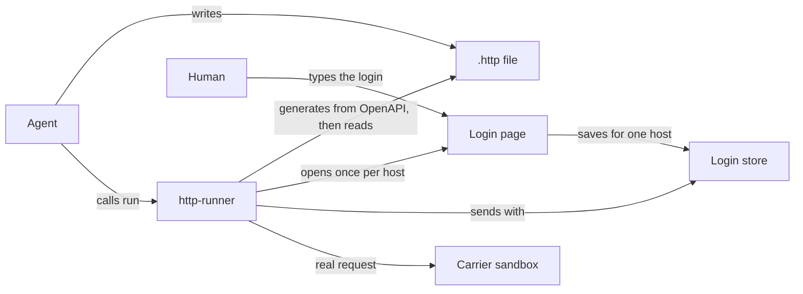
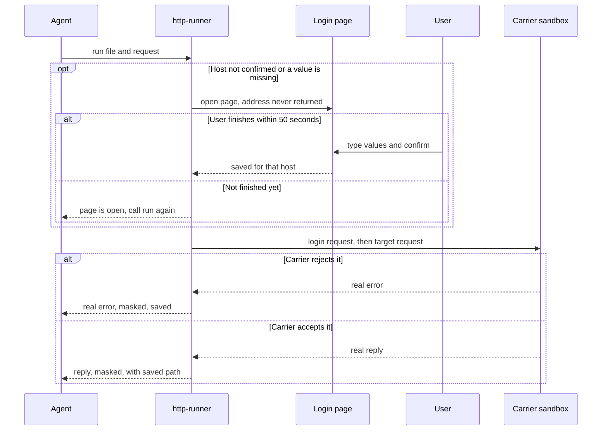

# carrier-api-integration: spec

## Problem and point

When the user integrates a carrier API at work (DHL over REST, DPD over SOAP), the agent cannot run a request itself. It gets the request or the login wrong and hands it back, so the user runs a `.http` file in VS Code REST Client and pastes the reply into the chat. Without a real reply, the agent guesses what comes back and writes tests around its guess, and those tests pass while proving nothing.

`http-runner` is a local MCP server that closes that gap: it runs `.http` files for the agent and returns the carrier's real reply. For an API with an OpenAPI spec, the server generates a starting `.http` file and the agent edits it; for SOAP the agent writes the file itself. Either way the agent adds the login and iterates on the carrier's real errors. Each reply is saved in the project, and the DTOs, the mapping and the test fixtures are built from it.

The user's one manual step is typing the login once per host, on a page the server opens.

## What the user sees

The user asks the agent to integrate DHL Parcel DE and points it at the OpenAPI file.

1. The agent calls `generate` on the OpenAPI file with the sandbox as `base_url` and gets a `.http` file with one named request per operation, each carrying the spec's own first example as its body. It adds the login and changes what it wants to test. Secrets appear only as `{{$dotenv DHL_PASSWORD}}`.
2. The agent calls `run` on the file and the request name.
3. No login is saved for that host yet, so a browser page opens by itself. It shows the host, `api-sandbox.dhl.com`, and exactly the fields the requests name. The user types the values and saves.
4. The call continues. The agent gets the real reply, or the carrier's real error, with secret values masked. It corrects the file and runs it again.
5. Each reply lands in `http-replies/` in the project. The agent builds the DTOs and test fixtures from those files, not from what it expects.

DPD works the same way, without the generated file, because `generate` reads only OpenAPI. The request body is the SOAP XML the agent wrote from the WSDL, and the login token moves from the XML reply into a SOAP header through a reference such as `{{login.response.body.//authToken}}`.

## Goals

- The agent can run any request it writes and read the real reply without the user.
- An API with an OpenAPI spec starts from a generated file, not a blank one.
- REST and SOAP take the same path once the file exists: the body is text.
- The user does nothing but type the login once per host.
- A test fixture comes from a reply that really happened.
- Files stay ordinary REST Client `.http` files that the user can open in VS Code.

## Non-goals

- Reading WSDL or XSD, generating SOAP envelopes, converting JSON to XML. The agent reads the WSDL and writes XML.
- One MCP tool per API operation, or searching a spec. The agent reads spec files with its own tools.
- Generating DTOs. The agent writes them from saved replies, or runs the user's own generator.
- A recording proxy around the integration code.
- Production calls. See "Who may be called".

## Anti-goals

The work has failed, even if every test passes, if the user has to write `.http` files, keep a host list or edit a config file, or if a typed secret reaches the model or a saved reply.

## Tools

The server has two tools, and the list never changes (MCP revision 2026-07-28 allows no tool list that grows after a call).

`generate` takes `spec` (an absolute path to a local OpenAPI 3 file, YAML or JSON), `output` (an absolute folder path) and an optional `base_url`. It writes one `.http` file with one request per operation, named from the spec's `operationId`, and returns that file's path and how many requests have a body. It reads only that file, so it reaches no host, and it refuses to overwrite an existing file, so it cannot destroy the agent's edits. When it cannot read a spec, it returns a readable tool result and the agent writes the file itself.

A request's body is the first example the spec gives for it, copied word for word, so the agent starts from data the carrier published and never from an invented body. A request with no usable example gets no body and a comment saying so. A path parameter stays in the URL as `{name}`, and a comment lists every parameter of the operation. Text from a spec can reach the file only inside comments and bodies: a comment is forced onto one line, and a body that would break the file (one holding `{{` or a line starting with `###`) is left out with a comment saying so.

The generated file carries no login, so the agent adds it.

A spec's server address can be production, and DHL's spec lists production first. `generate` therefore uses a spec's address only when the spec lists exactly one. With several and no `base_url`, it refuses and lists them, so the agent picks the sandbox. If the one address is production, `run` opens the login page for that host and the user sees which host it is.

`run` takes `file` (an absolute path to a `.http` file), `request` (the name after `# @name`), and an optional `retype_login`. Both tools refuse a relative path, because an MCP server's working folder need not be the project. The `retype_login` flag reopens the login page for the hosts of that run before anything is sent. The agent sets it when the carrier rejects a login, because a mistyped or changed value would otherwise keep failing. A rejected login never reopens the page by itself, since a 401 can also mean the agent built the header wrong.

`run` returns the status, the headers, the body, the requests it ran first, and the path of each saved reply. A call that fails in a way the agent can act on (a parse error with its line, an unsaved login, a refused host, an HTTP error status, a SOAP fault) comes back as a readable tool result, not a protocol error.

A short skill in `http-runner`'s plugin tells the agent how to work: generate the `.http` file when the API has an OpenAPI spec and otherwise write it from the WSDL, edit it, run it, fix it from the real error, and build DTOs and fixtures only from saved replies, never from an imagined reply.

## The `.http` format

`http-runner` reads this part of VS Code REST Client's format, in REST Client's own syntax so the files open there unchanged:

- LF or CRLF line endings;
- requests separated by a line starting with `###`, whose remaining text is a comment; a block with no request in it is skipped; `HTTP/1.1` is optional on the request line, and a trailing `###` is allowed;
- headers, then a body after a blank line, kept as text, so an XML body is ordinary text;
- `# @name` and `// @name`, with a name of letters, digits, `_` and `-`, since it becomes a folder name; `#` and `//` comments;
- file variables, `@name = value`, usable in later lines;
- `{{$dotenv NAME}}` for secrets, which the runner fills from its own store, never from a `.env` file;
- `{{name.response.body.<JSONPath or XPath>}}` and `{{name.response.headers.<name>}}`;
- `{{$guid}}`, `{{$datetime iso8601}}`, `{{$timestamp}}`, since carrier requests need unique references and dates;
- `Authorization: Basic <user> <password>` and `Basic <user>:<password>`, which the runner Base64-encodes as REST Client does, because DHL logs in that way.

References into an XML reply use XPath 1.0 with no namespace map, as in REST Client, which calls `xpath.select(path, doc)`. A bare name matches only an element with no namespace, and `local-name()` reaches a namespaced one. DPD's saved schemas set no `elementFormDefault`, so `authToken` has no namespace and `//authToken` should match; no real DPD reply has tested that. A prefixed name such as `//ns2:authToken` cannot resolve without a namespace map, so the runner refuses it and points to `local-name()`. A reference selects a value and never computes one: XPath functions other than `local-name()` and `name()` in a predicate, a result that is not a node set, a node that is an element with element children or the document root, and JSONPath `?` filters are refused, because a changed copy of a value, or several values joined, gets past masking and the cross-host refusal.

Anything outside this list is a parse error that names the line and the unsupported construct, so the agent can rewrite it. Prompt variables, Azure sign-in tokens and body imports with `<` all fall outside it. So does a `Host` header, because the URL alone says where a request goes. The parser lowercases each host, so `API.example` and `api.example` are one host.

## How a run works

1. Parse the file and find the target request and every named request it references. Named requests run first, in dependency order, every time. Nothing is cached between calls: the MCP revision forbids relying on earlier requests, and a cached login adds expiry handling nobody needs yet. One `run` therefore costs one extra login request. Because named requests rerun, a chain that references a create request creates a new shipment on every run, so the skill tells the agent to keep chains to logins and to copy a value from a saved reply into a file variable.
2. Check each request's host and each `{{$dotenv}}` name against the login store. If anything is missing, open the login page and wait up to 50 seconds, which fits Codex's default 60-second tool timeout. If the user has not finished by then, the call returns a result that says the page is open for that host and tells the agent to call `run` again. The page stays open for five minutes across calls, and a second call for the same hosts opens no second page. A call that needs anything else replaces the page, so a page for a wrong host cannot block the retry; a call whose page was replaced sends nothing and its result says so. If no browser opens or the five minutes run out, the result tells the agent to ask the user. No result ever contains the page's address. After the page reports a save, the runner reads the store again and sends only when nothing is missing.
3. Send over https, following no redirects. Plain http is allowed only for `localhost` and `127.0.0.1`, which the tests use.
4. Substitute references from replies. The runner escapes each substituted value to suit where it lands: XML-escaped in an XML body, JSON-escaped in a JSON body, percent-encoded in a URL or form body. Without escaping, an `&` in a password would break the request, and the agent, which cannot see the password, could not work around it. Escaping is the one place the runner differs from REST Client, which inserts values as they are. The runner refuses to send a reply value that equals or contains a value typed for another host in the run, and the result names the request and its line; otherwise a reply echoing a password could carry it to a host the user never typed it for.
5. Mask each exchange when it completes, and every error text, by the rules in "What gets masked". The runner decides which reply values to mask from the whole parsed file before it sends anything, and adds any credential-named value from the reply itself, so a login reply is not saved with its token readable, even when the login is run alone.
6. Save the masked exchange, then return the result, cut to 40,000 characters after masking, with a note saying where the whole reply is.

The whole call may last 55 seconds. If it runs out of time, the result lists what was sent, what came back and what was still in flight, and says an in-flight request may have completed at the carrier. It tells the agent to call `run` again only when nothing was sent, because repeating a create request makes a second shipment. Every exchange that completed is saved.

## What gets masked

Fixtures are the reason replies are saved, so masking covers credentials and leaves carrier data readable.

- Every value the user typed is masked, user names and account numbers included.
- A value taken from a reply by a `{{name.response...}}` reference is masked only when a request sends it in a header or inside a SOAP header. A login token is therefore masked, and a shipment number used in a URL or body stays readable.
- In the reply to a request that carried a typed value or a reply value the run has masked, a value is also masked when its JSON key, XML element or response header is named like a credential, ignoring case, `-` and `_`: a name containing `token`, `session`, `jwt`, `secret`, `password` or `apikey`, the name `sid`, `Set-Cookie` and `Authorization`. This holds whether or not the file references the value yet, so a login run alone is covered, and so is a refresh that sends only an earlier token. An unusual name stays readable until a request sends the value in a header, and a real field with such a name is masked in the fixture.
- One reply adds at most 256 such values, 64 KiB in all, because masking time grows with their number. A reply over either limit is withheld: the result and the saved file keep its status and say why, and hold no part of its body or headers. The same limits cover values taken by reference.
- A reply over 32 MiB after decompression is withheld the same way, and so is one whose masking cannot finish before the call's deadline. Either result says the request completed at the carrier, so the agent does not repeat it.
- A reference into an XML reply nested deeper than 256 levels is refused, because evaluating a path over it can exhaust the stack.
- Masking covers each value in plain, XML-escaped (named and numeric entities), JSON-escaped (`\uXXXX` included) and percent-encoded form, and the Base64 of a Basic header.
- A value of only digits is replaced by the same number of nines, so a JSON number stays a number, and it matches only where no digit adjoins it, so a longer number containing it stays intact. When a request joins such a value to other digits, as a DHL billing number does, the whole run of digits is masked. Any other value becomes `***`.
- The login page refuses a typed value shorter than four characters, because masking it would rewrite unrelated text. A reply value that short is left unmasked for the same reason.

## Who may be called

The user's earlier decision stands: "prod never". The server cannot tell a sandbox from production, and the user ruled out a host list to maintain as manual work. So the step that collects the login also guards the host: a host can be called only after the user has confirmed it on the login page, and the page says in large type which host the values go to. The user confirms each exact host name once. A host whose requests name no secrets gets the same page with only a confirm button. The server stores a typed value for one host and sends it only to that host. The user confirmed on 2026-11-09 that this page is the only guard, with no check of the host's name for "sandbox" or "stage".

So a `.http` file written to send `{{$dotenv DHL_PASSWORD}}` to another host, whether by a mistake or by text planted in a spec, finds no saved value and opens the page showing that other host. The user who types a production login on that page has chosen to. A typed value cannot travel inside a reply either; step 4 of "How a run works" refuses that.

## The login page

The login page is a local page on `127.0.0.1`, at a random port and a one-time address. The server opens the browser itself, and no tool ever returns the address. The page lists the host and the field names, takes the values, saves them, and closes. It accepts only requests that carry its token and pass a `Host` and `Origin` check, because any local web page can reach a loopback port.

The typed values live in a per-user file outside the project, readable only by the user. This file keeps the model from seeing them through a tool result, but it does not stop an agent with a shell, running as the same user, from reading it. The stakes are sandbox credentials. The design leaves out the OS keychain because the earlier run's keychain crate was never shown to link for the target the installer downloads, and a keychain would bring a dependency for little gain here.

## Saved replies

The runner saves each exchange, masked, in the folder of the `.http` file as `http-replies/<file stem>/<request name>/<timestamp>.json`, a file holding the request and reply, with a timestamp free of colons so the name is valid on Windows. A base64 body above 4 KB (such as a DPD label) is written beside it as its own file, masked like the rest, and that file's name replaces the body. Nothing is deleted automatically. The folder is meant to be committed once reviewed, since fixtures are its purpose.

## Seams

- Secrets: resolved in `store` and `run` at send time; never seen by `parse`, `replies`, the tool result, or logs (masking in `run`).
- Destination: resolved in `store` (a value belongs to one host) and checked in `run`; never decided in `parse` (which only reads the host from the file), `tools` or `replies`.
- `.http` syntax: resolved in `parse`; never seen by `run`, `store`, `replies` or `tools`, which take parsed requests.
- Asking the human: resolved in `login_page`; never seen by `parse`, `replies` or `tools`.
- Generating from OpenAPI: resolved in `generate`; never seen by `parse`, `run`, `store`, `login_page` or `replies`, which only ever see a `.http` file.
- REST versus SOAP: resolved nowhere; a body is text, and XPath or JSONPath is chosen by the reference the file contains.

## Build

`http-runner` is a Rust crate, `tools/http-runner`, in the root workspace, on the workspace's rmcp (3.9.0), with its plugin under `plugins/opt-in/mcp/`. It targets Claude Code and Codex and is built for Windows and Linux x64, as `web-mcp` and `ado-mcp` are. It uses `reqwest` from the workspace, plus `jsonpath-rust` and `sxd-xpath`. `generate` is our own code on one YAML crate, `serde_norway`, so the installer downloads nothing beside `http-runner`. Nothing is reused from the `openapi-mcp` branch unless the plan finds a part that fits unchanged.

## Pictures

This picture shows where `http-runner` sits. Nothing here has been built, so the shape is inferred from this design.



This picture shows the main flow and its failure cases.



This feature should touch these files, predicted from the grounding.

```files
+ tools/http-runner/Cargo.toml
+ tools/http-runner/src/main.rs
+ tools/http-runner/src/lib.rs
+ tools/http-runner/src/parse.rs
+ tools/http-runner/src/extract.rs
+ tools/http-runner/src/store.rs
+ tools/http-runner/src/mask.rs
+ tools/http-runner/src/login_page.rs
+ tools/http-runner/src/run.rs
+ tools/http-runner/src/replies.rs
+ tools/http-runner/src/generate.rs
+ tools/http-runner/src/tools.rs
+ tools/http-runner/tests/bin/fake_browser.rs
+ tools/http-runner/tests/common/mod.rs
+ tools/http-runner/tests/login_page.rs
+ tools/http-runner/tests/run.rs
+ tools/http-runner/tests/mcp.rs
+ docs/features/carrier-api-integration/agent-check.mjs
+ plugins/opt-in/mcp/http-runner/plugin.json
+ plugins/opt-in/mcp/http-runner/skills/http-runner/SKILL.md
~ Cargo.toml
~ Cargo.lock
~ plugins/catalog.json
~ tools/installer/assets/tools.json
~ tools/installer/steps/binaries.ts
~ tools/installer/install.ts
~ tools/installer/core/options.ts
~ tools/installer/core/codex.ts
~ tools/installer/steps/codex.ts
~ tools/installer/core/catalog.test.ts
~ tools/installer/core/plugins.test.ts
~ tools/installer/steps/codex.test.ts
~ tools/harness-compiler/src/templates/codex.ts
~ scripts/ci-changes.mjs
~ scripts/ci-changes.test.mjs
~ scripts/release.test.mjs
~ .github/workflows/release.yml
~ flake.nix
~ README.md
~ AGENTS.md
~ GLOSSARY.md
```

## What was measured

- httpyac 6.16.7 could not run REST Client's reply references, in JSON or XML (one run each against a local fake server), which is why the parser is ours.
- `rest_parser` 0.1.7 failed on an omitted `HTTP/1.1` and a trailing `###`.
- httpgenerator 1.1.0 reads no examples and gave DHL's `POST /orders` the body `{"profile":"example","shipments":["item"]}`, although the spec holds 11 complete bodies, which is why `generate` is ours.
- `serde_norway` 0.9.42 read DHL's OpenAPI file with its order kept. The first example of `POST /orders` came out complete, 872 characters of JSON.
- `sxd-xpath` 0.4.2 read the bare-name and `local-name()` paths on a SOAP reply shaped like DPD's, and panics on a prefixed name, which is why the runner refuses those. `xpath-eval` parses no XML, so it was dropped.
- `reqwest` puts the URL in its error text, which is why every error is masked and stripped of the URL.
- All are recorded in the Findings section of [flow.md](flow.md).

## Done means

1. DHL sandbox, live: from the OpenAPI file and a typed login, an agent creates a sandbox shipment order with no other help. Needs the user's sandbox API key.
2. DPD, against a fake server built from the saved WSDLs: login, a token from the XML reply into a SOAP header, and a `storeOrders` reply, with no manual step. The live DPD check waits for a stage login.
3. An unprompted-agent check, live on the DHL sandbox: headless agents given only a spec file and "create a shipment" reach a successful reply and write a test fixture from the saved reply. The user types the DHL login once beforehand, so the agents find it saved. The plan sets the runs and the pass mark, and the result is reported.
4. A typed secret and a login token never appear in a tool result, a saved reply (the login's own reply included) or a log, in any form listed under "What gets masked". A shipment number used in a URL stays readable in the saved reply.
5. A value stored for one host is not sent to another, directly or inside a reply value; a request to an unconfirmed host is not sent before the page is confirmed, even when it names no secrets.
6. The address of the login page appears in no tool result.
7. A file the agent wrote parses unchanged in REST Client's documented syntax; the user opens one in VS Code once to confirm.
8. From DHL's OpenAPI file, `generate` writes a `.http` file that `run` can parse unchanged, its `createOrders` request carries DHL's first example word for word, and it refuses to overwrite an existing file.
9. The repository's checks pass.

## Risks and what is not known

- The design hopes that real errors will make the agent more likely to write a correct first request. Item 3 of "Done means" measures that; nothing has measured it yet.
- `sxd-xpath` was last published in 2018, and only a reply shaped like DPD's has tested it, not a real one.
- Nobody has measured whether a browser opens from the MCP server on the user's Windows setup. Over SSH it will not; the run then tells the agent to ask the user.
- `generate` is only as good as a spec's examples. An operation with none gets no body, and the agent writes that one from the schema, as for SOAP.
- With headroom-trim installed, a `run` result may be shortened before the agent reads it. The saved reply stays whole, and the skill sends the agent there.
- SOAP stays the weak spot, since nothing generates a starting file from a WSDL. Building that would need the XSD reader the user rejected as too heavy.
- Which DPD the user means is unconfirmed; the fixtures are DPD Germany.

## Calls I made for you

Each is my choice and is open to change:

- the name `http-runner`;
- `generate` reading only a local file and refusing to overwrite one;
- `generate` naming each request from the spec's `operationId`, and refusing a spec with several servers and no `base_url`;
- absolute paths only, in both tools;
- no login caching;
- the 50-second wait per call;
- escaping substituted values by where they land;
- the four-character minimum for typed values;
- a user-owned file instead of the OS keychain;
- saved replies inside the project;
- `{{$dotenv}}` as the secret form.
