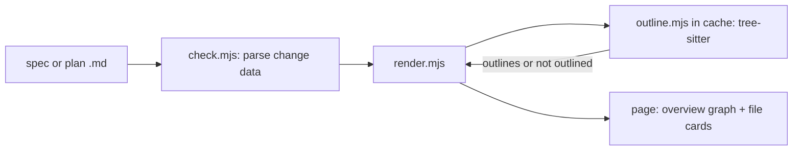

# Change map: spec

## Goal

At a gate, the user sees at a glance what a spec or plan changes, without reading prose: which files, what in each
file, where things move, and how the changed parts relate. Today's file map (a folder tree of `+ ~ - >` paths,
`render.mjs:55-99`) shows only which files change.

Not in scope: real git diffs (later, same data model), treemaps / size areas, editing the page.

## What the user sees

Two levels on the existing diagrams page, in place of today's tree:

1. **Overview** (one per `files` block, and the plan's map): a Mermaid flowchart drawn from the change data. Folders
   are subgraphs, changed files are nodes coloured by marker (add green, change amber, delete red, move cyan), a
   dashed arrow is a move (file or symbol, labelled with the symbol), a solid arrow is a declared `uses` relation.
   Clicking a file node opens and scrolls to its card.
2. **File cards** (one per file, below the overview, collapsible): the file's **real outline** read from the repo
   (functions, classes, methods, types, in file order, with line numbers), each symbol the change touches marked
   `+ ~ - >` with its one-line why; untouched symbols grey. A new file shows only its predicted symbols. A file with
   no supported grammar shows its predicted symbols and says "no outline for this file type".

## The format (author-written)

An extension of the ` ```files ` block; every existing block stays valid.

```text
~ plugins/flows/skills/diagrams/scripts/render.mjs  draw the overview and cards
    + overviewMermaid  builds the flowchart text
    ~ listHtml  becomes the file cards
    - planMapHtml
    > treeHtml -> plugins/flows/skills/diagrams/scripts/cards.mjs
+ plugins/flows/skills/diagrams/scripts/outline.mjs  tree-sitter outlines
plugins/flows/skills/diagrams/scripts/render.mjs uses plugins/flows/skills/diagrams/scripts/outline.mjs
```

- File line: marker, path, optional why (rest of the line).
- Symbol line: indented under its file, marker, symbol name, optional why; `>` takes `-> <path>`.
- Relation line: `<path> uses <path>`, both paths listed in the block.
- Plans: a task may carry one ` ```files ` block in the same syntax (symbols, whys, `uses`) below its **Files** list;
  every path in it must be in that task's **Files** list (error otherwise). The Files list stays plain paths. (Changed
  at Gate 2: indented lines under Files items are rewritten by prettier, `+` → `-` and `>` → blockquote, measured
  2026-11-16 with prettier 3.10.1.)
- A why is separated from its path or symbol by two or more spaces, so a path with one space stays an error.
- SKILL.md asks the author to list predicted symbols for every `~` file; a `~` file without them is a warning, not
  an error.

## Checks

- Existing file-path checks stay (spec: warning, plan: error).
- `~ - >` symbol not found in the file's real outline: warning (spec and plan), naming the file and the symbol.
- `+` symbol already in the outline: warning.
- Relation naming a path not in the block: error.
- Over 12 file nodes: the generator draws one flat node per folder that holds files, labelled with its counts, and
  the edges between folders (built in Node, no Mermaid collapse feature); every file still gets its card.
- The generated overview is parse-checked by Mermaid like a hand-written diagram, exempt from the 8-node and orphan
  rules.

## Outline

- tree-sitter via `web-tree-sitter` plus grammar `.wasm` files, installed by the checker into its existing user cache
  (`check.mjs:126-150`) from pinned `package.json` / `package-lock.json`, never into the plugin folder.
- Languages first: JS/TS, Rust, C#, Python (by extension). Others: no outline, no error.
- No outline (no npm, offline, install fails): page renders cards from the author's symbols with
  `warning: not outlined: <reason>`, like today's `not parser-checked`.

## Language of the tool

Node ESM, like the rest of `diagrams/scripts/`; web-tree-sitter is tree-sitter's official JS binding (to verify in the
plan with its docs).

## Seams

- Change data (files, symbols, moves, relations): resolved in `check.mjs` (`parseFilesBlock`, `planMap`); never seen
  by `outline.mjs` or the page script as markdown.
- Real outline and language by extension: resolved in `outline.mjs`, run from the cache folder; never seen by
  `check.mjs`'s parsing, `render.mjs`'s HTML builders or the page.
- Repo access: `render.mjs` / `check.mjs` (given `root`); the page never reads files.

## Where it lands (predicted)

```files
~ plugins/flows/skills/diagrams/scripts/check.mjs
~ plugins/flows/skills/diagrams/scripts/render.mjs
+ plugins/flows/skills/diagrams/scripts/outline.mjs
~ plugins/flows/skills/diagrams/package.json
~ plugins/flows/skills/diagrams/package-lock.json
~ plugins/flows/skills/diagrams/SKILL.md
~ plugins/flows/skills/diagrams/tests/check.test.mjs
~ plugins/flows/skills/diagrams/tests/render.test.mjs
~ docs/components/flows.md
```



If the outline step fails (no npm, offline), `render.mjs` still writes the page with the author's symbols and prints
`warning: not outlined: <reason>`.
