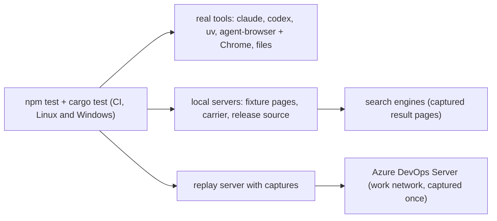
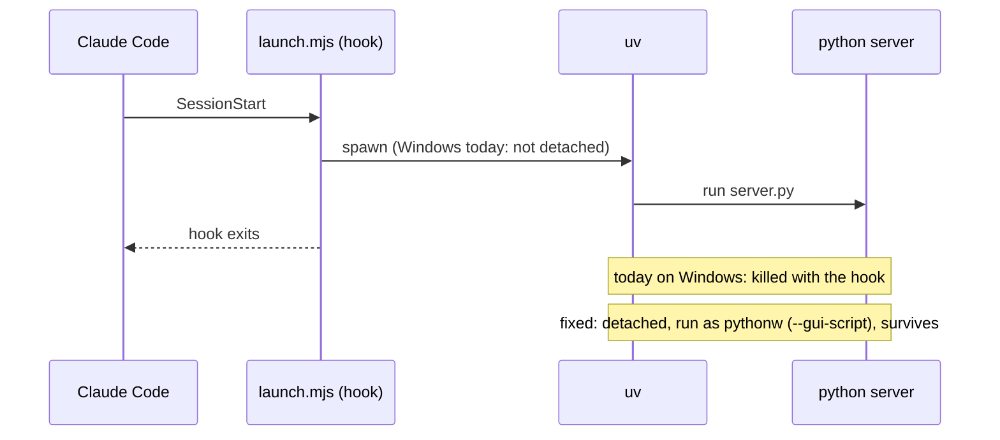

# Integration-first testing: spec

## Intent

The user: "It doesnt help me to test against mocks when my actual stuff doesnt work." The motivating failure: on
Windows, opening a new Claude Code session, headroom-trim's server "started and instantly closed again", while every
test was green. The launcher's tests inject a fake `spawn` and `fetch` (`hooks/launcher.test.mjs:159-192`); nothing
runs the real `launch.mjs` → uv → server.

This repo's own suites move to testing against the real collaborators. The test guidance flows gives agents in other
projects is out of scope.

## Goals

1. One rule, written once in AGENTS.md "Checks": a test runs the real thing (process, CLI, browser, filesystem,
   local server). Only what CI cannot host is answered by a replay server, and only from captures (real answers with credentials and identities masked).
   A test whose real tool is missing fails under `--strict` (CI), and shows as NOT RUN locally, as the `mods` and
   `python` suites already do.
2. One suite: `npm test` and `cargo test --workspace`, gating every merge in CI (ubuntu and windows). No separate live
   suite. Inside `npm test`, the slow real Node tests (headroom through `claude -p`, the installer end to end) form a
   `real` suite of `scripts/test.mjs` that the pre-commit hook and the release jobs leave out; the installer's 84 %
   coverage floor moves to it (plan review F1).
3. headroom-trim: a test runs the SessionStart hook through the real Claude Code (`claude -p --plugin-dir` on the
   built headroom-trim package, a temporary `CLAUDE_CONFIG_DIR`; measured: hooks run without a login), with the real
   pinned uv, and checks the server still answers `/health` after claude has exited, then shuts it down. It fails on
   Windows today and passes after the fix. Cause, measured (flow.md **Findings**): on Windows a hook's non-detached
   child dies when the hook exits, and the launcher doesn't detach on Windows (`launcher.mjs:143`) so python.exe opens
   no visible console. The fix is in this run: the server outlives the hook on Windows and still opens no window.
4. Installer: a test runs `install.ts` end to end, unattended through a test-only environment seam (an answers file
   for every prompt, and a local release: the freshly built marketplace tree and the cargo-built binaries served over
   local HTTP with their `.sha256`), on a fresh temporary HOME (`HOME`/`USERPROFILE`,
   `CLAUDE_CONFIG_DIR`, `CODEX_HOME`) with the real `claude` and `codex` CLIs, the pinned and hash-checked downloads it makes (`assets/tools.json`,
   `uv.lock`) plus Chrome for Testing through `agent-browser install` (the F2 exception, Goal 5), and the
   repo's freshly built tree, then checks the result through the CLIs (`claude plugin list --json`,
   `codex plugin list --json`, `codex mcp list --json`) and the files written. This covers the eight steps that have
   no test today (`agent-browser`, `binaries`, `ccstatusline`, `clean`, `dcg`, `plugins`, `settings`, `uv`).
   Downloads that are not pinned and hash-checked (dcg's install script from `main`, graphify's `graphifyy` from PyPI, `serena-agent` once ADR 0016 merges) don't
   run in a gating test; see Open decisions.
5. web-mcp and browser-core: tests drive the real agent-browser (the installer's pinned version) and real Chrome
   (Chrome for Testing via `agent-browser install`, whichever version it installs: the one named exception to "pinned
   only", since that is the Chrome users get; plan review F2) against pages served by the existing local fixture
   server. The engine result pages are real captures: those already in `tests/fixtures/engines/`, plus the missing
   variants taken once through web-mcp's archive; a variant no engine shows on demand stays hand-shaped and says so
   (plan review F3).
   Search engines are not contacted: a debug-build-only environment setting (like `WEB_MCP_TEST_PUBLIC_IP`) swaps the
   engine base URLs for the fixture server, which serves the captured result pages. The fault cases the fake
   simulates today (a closed tab, a dead CDP connection, a relaunched Chrome, a slow page, a blocked or consent page)
   are produced for real (closing the tab, killing Chrome, a slow route, the captured block page).
6. http-runner: the login page is opened in a real browser (real Chrome, driven so the test can fill and submit the
   form) instead of `fake-browser`; the remote API stays a local server (`common::Carrier`), since the carrier is
   remote and paid.
7. ado-mcp: its server stays a local replay server, since the user's Azure DevOps Server 2022.2 is on a work network.
   Its fixtures are today shaped from the docs, not captured (`docs/features/ado-mcp/spec.md:204`,
   `docs/components/mcp-azure.md:152-158`). This run adds an opt-in capture mode that writes the server's real answers
   with credentials and identities masked, and a test of the masking; the user runs it once at work, and the masked
   captures replace the doc-shaped fixtures in a later commit.
8. Old tests: a test that injects a fake or mock is deleted once a real test covers its behaviour. Pure-logic tests
   that fake nothing (parsers, `decide`, `identityOf`, the ~380 inline Rust tests on pure code) stay.

## Non-goals

- Changing flows' test guidance (builder brief, Test seams, review lens) or any vendored pack.
- Live search engines, a live Azure DevOps or a live carrier API in CI.
- Raising or adding coverage floors.

## Anti-goals

- A green suite that skips the real part: a real-tool test that silently passes when its tool is missing.
- A second suite or a manual-only check standing in for one of the goals above.
- Merges going red at random: every real test is deterministic against local servers and captured pages.

## Constraints

- CI: GitHub's ubuntu and windows runners. Verified for Ubuntu 24.04: Chrome 157, Chromium, xvfb installed
  ([runner-images readme](https://raw.githubusercontent.com/actions/runner-images/main/images/ubuntu/Ubuntu2404-Readme.md)).
  Windows runner browser and headed-window behaviour: assumed, not checked.
- web-mcp launches Chrome headed (`browser-core/src/profile.rs:194`); Linux CI needs a display (Xvfb).
- Engine URLs are hardcoded https hosts (`web-mcp/src/engines/*.rs`); the fixture server is plain HTTP.
- The installer has no unattended mode (`install.ts:81-84` TTY guard; every `ask` and `screen` needs a TTY), and it
  downloads the Rust binaries from the release of its own version, which doesn't exist yet in a PR
  (`core/tools.ts:60-66`).
- The installer has no runtime npm dependencies; Node runs its `.ts` files directly.
- Debug-only test hooks (`WEB_MCP_TEST_PUBLIC_IP`, `HTTP_RUNNER_OPEN`) exist; tests run in debug builds.
- Vendored paths are not edited.

## Approaches

- **A, picked: one suite, real wherever CI can host it, captured real exchanges for the rest.** Real processes,
  CLIs, Chrome and files; live engines and the ADO Server replayed from captures. Deterministic, gates every merge;
  upstream drift shows only on re-capture. (Google SWE ch. 13 "hermetic instance"; Fowler, SelfInitializingFake;
  prior-art.md.)
- B, rejected: fully live (engines and a cloud ADO org in CI): random reds from engine blocks, not the user's Server
  2022.2, no secrets on Dependabot PRs.
- C, rejected, the smallest that would work: only the headroom launcher path goes real.
- Rejected earlier: a separate opt-in live suite (user: "Dont want two test suits"); local-only real tests.

## Seams

- Finding a real tool for a test (claude, codex, uv, agent-browser, Chrome): resolved in `scripts/test.mjs` (Node
  suites) and each crate's `tests/common/mod.rs` (Rust); never seen by test bodies or by product code.
- Serving captured engine pages in place of the real engine hosts: resolved where web-mcp builds an engine's base URL
  (one debug-only override, set by `tests/common/mod.rs`); never seen by the engines' parsers, search fusion or fetch.
- Unattended installer runs: resolved where the installer asks (its prompt and screen functions read the answers
  file) and where it picks a release source; never seen by the steps.

## Decided in brainstorming

- Network: a gating test may download only what is pinned and hash-checked (user), except Chrome for Testing,
  whichever version `agent-browser install` fetches (plan review F2, user).
- Installer: a test-only environment seam, not a pty and not a public `--yes` flag (user).
- Engines: a debug-only base-URL override, not Chrome host rules with TLS (user).
- ado-mcp: build a capture mode; the user captures at work (user).
- My calls: the Rust real-browser tests run in `crates.yml` on both OSes; if headed Chrome can't run on a runner,
  that stops the build as a deviation; a fake-only behaviour with no real way to provoke it keeps its fake test with
  a one-line reason, and a fake goes only once nothing uses it.

## Decided in the grill

1. Unpinned downloads: the gating installer test turns dcg and graphify (serena once ADR 0016 merges) off and lists them as not covered; none is
   pinned (`tools.json` names graphify with no version; serena is unpinned on purpose, ADR 0016).
2. headroom fix on Windows: the launcher starts the server detached on Windows too, through uv's `--gui-script`, so
   python runs as `pythonw.exe` and opens no console window (uv 0.13.9 has the flag, measured). If pythonw loses
   `server.log` or the server doesn't start, that is a deviation.
3. ado-mcp capture mode: off by default; an environment variable naming an output folder turns it on, in the release
   build. It writes response bodies only, into that folder only. It replaces emails, display and unique names, user
   ids and descriptors, and the server's host name (`dev.example`); it keeps other GUIDs so shapes stay real. A test
   feeds it a real-shaped answer and checks that no original identity or host survives. The user reviews the files
   before committing them.
4. CI binaries: `test.yml` builds `web-mcp`, `http-runner` and `ado-mcp` (debug, cached) before `npm test`; the
   installer test serves exactly those.
5. ADR: [0017](../../adr/0017-tests-use-the-real-thing.md).
6. Coverage: code a test runs in a child process counts toward the installer's 84 % line floor (measured, Node
   26.8.1), so the end-to-end run carries the coverage of the mocked step tests it replaces.
7. Glossary: the new **Testing** section in `GLOSSARY.md` (real test, capture, replay server, fake).

## Decided in plan review

Round 1 (2026-11-24), user, Gate 1 reopened for these items:

- F1: a `real` suite in `scripts/test.mjs` (see Goal 2).
- F2: Chrome for Testing is the named exception to pinned downloads (see Goal 5).
- F3: engine pages captured in this run (see Goal 5).
- F4: the Nix packages run only the Rust tests that start no browser, with the reason in `flake.nix`; crates.yml's
  rust job is the gate.

## Left to the builder

Test file layout, helper names, timeouts, how a fault is provoked, CI step order.

## Pictures

What the one suite talks to: real tools wherever CI can host them, replay servers only for what it can't.



The headroom failure today (measured) and after the fix:



Predicted file map (from the grounding; the plan's tasks settle it):

```files
~ AGENTS.md  the rule in Checks
+ docs/adr/0017-tests-use-the-real-thing.md  the decision
~ GLOSSARY.md  Testing section
~ plugins/opt-in/headroom-trim/hooks/launcher.mjs  detached and --gui-script on Windows
    ~ main  detached on every platform
    ~ startArgs  --gui-script on Windows
~ plugins/opt-in/headroom-trim/hooks/launcher.test.mjs  injected-spawn tests go once the real test covers them
~ tools/installer/ui/ui.ts  answers file for every prompt
    ~ screen  reads the answers file
    ~ confirm  reads the answers file
~ tools/installer/core/tools.ts  local release source
    ~ resolveTool  local release base
~ tools/installer/install.ts  TTY guard passes with an answers file
- tools/installer/steps/codex.test.ts  covered by the end-to-end run
~ tools/web/web-mcp/src/engines/mod.rs  debug-only base-URL override
    ~ url  base from the override in debug builds
~ tools/web/web-mcp/tests/common/mod.rs  real agent-browser and Chrome
- tools/web/web-mcp/tests/bin/fake_agent_browser.rs  replaced by the real agent-browser
~ tools/http-runner/tests/common/mod.rs  real browser opens the login page
- tools/http-runner/tests/bin/fake_browser.rs  replaced by real Chrome
~ tools/ado-mcp/src/remote.rs  opt-in capture of masked answers
~ scripts/test.mjs  real-tool preconditions per suite
~ .github/workflows/test.yml  codex, Rust binaries, agent-browser and Chrome
~ .github/workflows/crates.yml  agent-browser, Chrome for Testing, Xvfb
tools/web/web-mcp/tests/common/mod.rs uses tools/web/web-mcp/src/engines/mod.rs
```

The new real tests (headroom through `claude -p`, the installer end to end) get their own files; their names are left
to the builder. A fake that survives because nothing real can produce its behaviour stays, with its reason.
