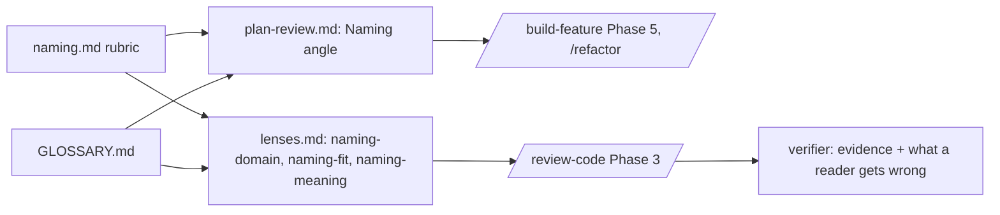

# Naming review in plan review and /review-code: spec

## Why

The most common complaint on the user's PRs is naming. Today nothing in flows judges a name: plan review's angles
(Correctness, Fit, Simpler) skip it, `writing-plans` only checks a name is spelled the same in every task
(`packs/superpowers/skills/writing-plans/SKILL.md:171`), and `/review-code`'s shared tail says "No style taste"
(`review-code/references/lenses.md`, Shared tail), which keeps naming out of every lens.

## Goals

1. Plan review checks the names a plan introduces before code exists.
2. `/review-code` checks every name a diff adds, including private names, locals and test names, from three angles.
3. One rubric defines what a bad name is; plan review and every naming lens read it, none restates it.
4. A naming finding needs evidence; a name the reviewer merely dislikes is no finding.

## The four kinds of bad name

1. **Domain**: a word `GLOSSARY.md` lists under `_Avoid_`, a word that means something else in the glossary or spec,
   or a new domain concept with no glossary term.
2. **Fit**: breaks the casing, prefix, suffix or file-naming pattern of its neighbours, or reuses a name that already
   means something else in the repo.
3. **Meaning**: the name doesn't say what the thing does: vague (`utils`, `manager`, `handle`, `data`), misleading
   (says one thing, the code does another), or too narrow or too broad for what it holds.
4. **Plan text** (plan review only): task headings, the run's slug, and the names the steps use for things.

## Design

### The rubric: `plugins/flows/references/naming.md`

Holds the four kinds, the evidence rule, the severity rule and the naming tail. Each kind says what to check against
and what a finding cites:

| Kind    | Checked against                                                        | A finding cites                                       |
| ------- | ---------------------------------------------------------------------- | ----------------------------------------------------- |
| Domain  | `GLOSSARY.md` (or the file `GLOSSARY-MAP.md` points at), the spec      | the glossary entry or `_Avoid_` line, or the spec line |
| Fit     | names near it and across the repo (search)                             | the clashing or established name, `file:line`         |
| Meaning | the code behind the name (in plan review: the task's steps)            | the `file:line` where the code does what the name hides |
| Plan text | the plan's tasks and the spec                                        | the heading or step and what it misnames              |

- **No glossary.** Domain then checks against the spec only; "no glossary term" is raised only where a glossary
  exists. (Plan review round 1.)
- **Evidence rule.** Every finding cites one of the above and proposes one or two better names. No citation, no
  finding: taste alone is dropped, not downgraded.
- **Severity.** Naming is never **blocking**. A misleading name (Meaning), an `_Avoid_` word, or a clash with an
  existing name that means something else is **should-fix** in plan review and `med`, bucket `fix before merge`, in
  `/review-code`. Any other evidenced finding (a pattern mismatch that confuses nobody, a missing glossary term) is
  **consider** in plan review and `low`, bucket `worth doing`, in `/review-code`. (User, 2026-11-25.)
- **Naming tail.** Replaces `/review-code`'s shared tail for the naming lenses (that tail's "No style taste" would
  silence them) and adds to plan review's tail: each finding names the name, its `file:line` (or plan task), the kind,
  the evidence, the proposed names, and what a reader gets wrong with the current name.
- **Scope.** Only names the change adds or renames. Names that already existed are out of scope, also when bad.

### Plan review (`build-feature/references/plan-review.md`)

- A fourth angle, **Naming**, always runs: the rubric's four kinds on every name in the plan's `**Adds:**` lines, the
  task headings, the slug and the names the steps use.
- The Naming reviewer additionally gets `GLOSSARY.md` (or the file `GLOSSARY-MAP.md` points at) when the repo has one.
- Angles stay one per model where the host offers more than one; four angles on three model tokens means one model
  runs two angles, each still a fresh agent.
- `/refactor` reuses plan-review.md for a restructuring and gets the angle with it, unchanged.

### /review-code (`review-code/references/lenses.md`)

Three new lenses, each a fresh agent on `{{model:standard}}`, briefed with its kind from the rubric and the naming tail:

| Lens           | Runs when                                                     |
| -------------- | ------------------------------------------------------------- |
| naming-domain  | the diff adds names and the repo has a glossary or the run has a spec |
| naming-fit     | the diff adds names (source, tests, files, config keys, flags) |
| naming-meaning | the diff adds names in source or tests                        |

- Small diff: they join the combined agent like every other lens.
- Their findings go through the same verifier as every other lens. For a naming finding the concrete case the
  verifier needs is the cited evidence plus what a reader gets wrong: the name says X, the glossary, a neighbour or the
  code at `file:line` says Y. Without it the candidate is dropped like any other.
- Not under `/review-code all`: with no change, every existing name would be in scope (user, 2026-11-25).
- `review-code/SKILL.md`'s description and `plugins/flows/README.md`'s lens list name the three lenses.

## Pictures

Where the rubric is read (the lenses and angles are fresh agents):



```files
+ plugins/flows/references/naming.md  the rubric: four kinds, evidence rule, severity, naming tail
~ plugins/flows/skills/build-feature/references/plan-review.md  fourth angle, Naming
~ plugins/flows/skills/build-feature/SKILL.md  Phase 5 says four angles
~ plugins/flows/skills/review-code/references/lenses.md  three naming lenses, their tail, skipped under all
~ plugins/flows/skills/review-code/SKILL.md  description lists the lenses
~ plugins/flows/skills/review-code/references/report.md  fix-before-merge bucket admits naming.md's should-fix
~ plugins/flows/README.md  /review-code row lists the lenses
~ docs/components/flows.md  plan review and lenses
~ GLOSSARY.md  Naming rubric
plugins/flows/skills/build-feature/references/plan-review.md uses plugins/flows/references/naming.md
plugins/flows/skills/review-code/references/lenses.md uses plugins/flows/references/naming.md
```

## Seams

- naming rules: resolved in `plugins/flows/references/naming.md`; never seen by `plan-review.md`, `lenses.md`,
  `review-code/SKILL.md` (they point to the rubric and name which kinds a reviewer runs, never restate a rule).

## Out of scope

- Renaming existing names; a naming pass under `/review-code all`.
- Writing the glossary: a missing term is a finding; adding it is the user's call (domain-modeling in the Grill).
- A per-repo rule list (Rust-style checklist): conventions come from the neighbours, not a maintained list.

## Docs to keep true

`docs/components/flows.md` where it describes plan review and the lenses; `plugins/flows/README.md`; the
`review-code` description; GLOSSARY.md gets **Naming rubric**.
