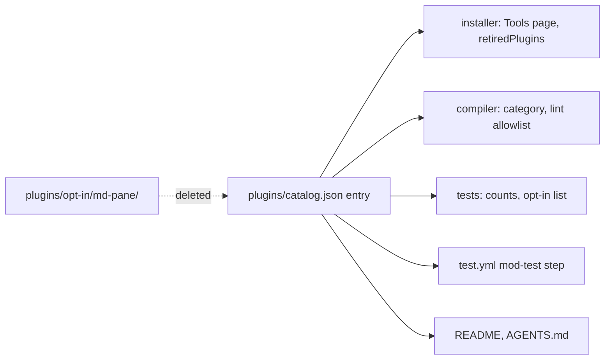

# Remove md-pane Implementation Plan

<!-- glance -->

```
Plan: Remove md-pane · 1 tasks · ~1000 lines · 13 files
 1  [1 Remove md-pane]

#  does                                                          files  adds         size
1  Deletes the md-pane plugin folder and removes the catalog e…  13     nothing new  ~1000
```

<!-- /glance -->

> **For agentic workers:** REQUIRED SUB-SKILL: use superpowers:subagent-driven-development or superpowers:executing-plans.

**Goal:** Delete the md-pane plugin and every reference to it. Nothing else changes.

**Architecture:** md-pane is a leaf plugin (`dependencies: []`, nothing depends on it). Removing it from
`plugins/catalog.json` makes the installer's `retiredPlugins` uninstall it from machines that have it.

**Tech Stack:** Node/TypeScript installer and compiler tests, JSON catalog, GitHub Actions YAML, Markdown.



The picture shows what reads the catalog entry or names the folder. All of it changes in the one task; no other plugin
depends on md-pane (verified), so nothing else is touched.

## Global Constraints

- Behaviour doesn't change: tests that passed before still pass.
- One implementation gets no interface; one caller gets no helper; no option nobody sets.
- Do not touch `docs/features/` other than this run's folder; those are history.
- Do not touch Night City (`plugins/default/`) or any other plugin.
- Run `treefmt` on each file you changed (never a folder), then `npm run build:harnesses`.

## Test seams

- `tools/installer/core/catalog.test.ts` — the real catalog's plugin count and Codex/Claude selection. Catches a
  leftover or missing catalog entry; misses nothing about md-pane's own code (deleted).
- `tools/installer/core/plugins.test.ts` — the opt-in list derived from the marketplace and `retiredPlugins`. Catches
  the plugin still being offered; misses the real installed state of a machine.
- `scripts/check-repo.mjs` (in `npm test`) — build, validation, lint allowlist, README/plugin consistency. Catches a
  dangling allowlist path or catalog source.

### Task 1: Remove md-pane

**Does:** Deletes the md-pane plugin folder and removes the catalog entry, installer option, build category, lint
allowlist entries, CI step, docs and test fixtures that name it.
**Depends on:** none
**Adds:** nothing new
**Size:** ~1000

**Files:**

- Delete: `plugins/opt-in/md-pane/` (whole folder, 10 files)
- Modify: `plugins/catalog.json`
- Modify: `tools/installer/core/options.ts`
- Modify: `tools/harness-compiler/src/targets/claude-code.ts`
- Modify: `tools/harness-compiler/src/lint-allowlist.json`
- Modify: `.github/workflows/test.yml`
- Modify: `README.md`
- Modify: `AGENTS.md`
- Modify: `scripts/plugin-dirs.test.mjs`
- Modify: `tools/installer/core/plugins.test.ts`
- Modify: `tools/installer/core/agents.test.ts`
- Modify: `tools/installer/core/catalog.test.ts`
- Modify: `tools/installer/steps/codex.test.ts`

- [ ] **Step 1:** `git rm -r plugins/opt-in/md-pane`.
- [ ] **Step 2:** Remove the `md-pane` object from `plugins/catalog.json`; drop `'md-pane'` from the Tools keys in
      `options.ts` and from the category list in `claude-code.ts`; delete the two `md-pane` entries in
      `lint-allowlist.json`; delete the "md-pane mod tests" step in `test.yml`.
- [ ] **Step 3:** README.md: drop md-pane from the Claude-only sentence (line 45) and remove the md-pane clause from the
      opt-in list (lines 60-61), keeping the sentence grammatical. AGENTS.md: delete the md-pane bullet (57-59), and in the
      mod-tests bullet (136-137) drop `.claude-plugin/md-pane`, `plugins/opt-in/md-pane` and the "CI doesn't run tsc" clause's
      second path.
- [ ] **Step 4:** Tests, names only except the two counts below:
  - `plugin-dirs.test.mjs:34-37`: assert on another real plugin (`plugins/opt-in/headroom-trim`) instead of md-pane; rename
    the test to match.
  - `plugins.test.ts`: remove `'md-pane'` from the expected opt-in list (line 50); in the retired test (105) use
    `graphify@${M}` in place of `md-pane@${M}`.
  - `agents.test.ts:18` and `catalog.test.ts:33`: `'md-pane'` → `'nix-lsp'` (still a Claude-only plugin).
  - `catalog.test.ts:28`: the Claude plugin count `16` → `15`.
  - `codex.test.ts:249`: drop `'md-pane'` from the list.
- [ ] **Step 5:** `npm run build:harnesses`, then `npm test` and `npm run typecheck`; both green.
      `git grep -n -i md-pane -- . ':!docs/features'` prints only the fixture rows in `plugins.test.ts` (~158-174), which
      use `md-pane` as an arbitrary id and stay.
