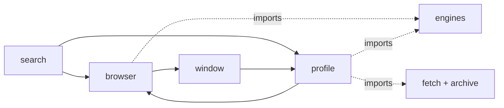
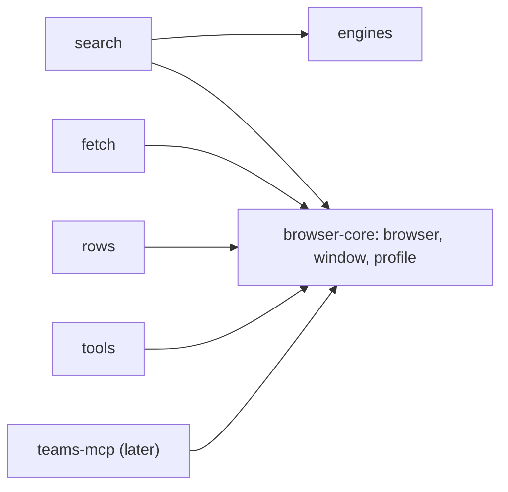

# Untangle web-mcp's browser code Implementation Plan

<!-- glance -->
```
Plan: Untangle web-mcp's browser code · 6 tasks · ~627 lines · 31 files
 1  [1 Per-engine marks and tu…]
 2  [2 Search's deadlines leav… ←1]
 3  [3 `profile.rs` stops impo… ←2]
 4  [4 `browser-core` crate ho… ←3]
 5  [5 Docs know the fourth cr… ←4]
 6  [6 A stale path in one sol… ←5]

#  does                                                          files  adds                            size
1  `Profiles` keeps rest and consent marks under a plain name …  5      `engines::Turns` (`new()`, `a…  ~150
2  the `search-<engine>` session name, the engine deadline and…  3      `browser::ATTACHED_TIMEOUT` (…  ~40
3  the cookie-extension download uses its own capped read and …  1      nothing new (two private func…  ~45
4  the three browser files move into a new library crate in th…  17     the `browser-core` crate (pac…  ~320
5  the docs say where the browser code lives, what the crate o…  4      nothing new (one component pa…  ~70
6  the one doc that still names `crates/web-mcp/src/profile.rs…  1      nothing new                     ~2
```
<!-- /glance -->

> **For agentic workers:** REQUIRED SUB-SKILL: Use superpowers:subagent-driven-development (recommended) or superpowers:executing-plans to implement this plan task-by-task. Steps use checkbox (`- [ ]`) syntax for tracking.

**Goal:** `browser.rs`, `window.rs` and `profile.rs` become the library crate `browser-core` that web-mcp depends on and a later server (the drafted teams-mcp) can use too, with web-mcp's behaviour unchanged.

**Architecture:** Tasks 1-3 untangle in place: per-engine search state (turns, rest and consent marks, the `search-<engine>` session name, the engine deadline and rest length) moves out to `engines` and `search`; `Profiles` keeps only name-keyed file marks; the cookie-extension download in `profile.rs` uses its own two small helpers instead of `fetch::read_capped` and `archive::sha`. Task 4 moves the three files into `tools/browser-core/` (a lib crate in the root workspace), re-points web-mcp and updates the scripts and Nix source list that name the crates. Task 5 is docs. The crate's public API is exactly the items web-mcp uses today. The fake agent-browser stays in web-mcp.

**Tech Stack:** Rust 2024, tokio, reqwest; the workspace's root `Cargo.toml`; Node scripts under `scripts/`.

**Spec:** `### Shape` and its `Picked:` line in [flow.md](flow.md) (this refactor has no spec); plan review round 1 in the same file.

## Before and after

Before: the three browser files import search and fetch code (`profile -> engines/archive/fetch`, `browser -> engines/profile::ENGINE_DEADLINE`).



After: engine state sits with `engines` and `search`; the three files form `browser-core`, which web-mcp (and later teams-mcp) depends on one way.



## Global Constraints

- Behaviour doesn't change: tests that passed before still pass.
- One implementation gets no interface; one caller gets no helper; no option nobody sets.
- search policy (which engine, its turn, the `search-<engine>` session name, the 10 s engine deadline and the 30 min rest): resolved in `engines` and `search`; never seen by `browser`, `window` and `profile`.
- rest and consent marks: `profile` owns the files, keyed by a plain name, never by an `Engine`; the name is chosen in `search`.
- attached-call timeout (8 s, part of agent-browser's daemon fingerprint): resolved in `browser`; never seen by `window`, `profile`, `fetch` and `rows` (`search` reads it only to derive its engine deadline).
- cookie-extension download (2 MiB cap, sha-256 check): resolved in `profile` with its own helpers; never seen by `fetch` and `archive`.
- crate API (which names are `pub`): resolved in `browser-core`'s `lib.rs` and the items' own visibility; web-mcp sees only items it uses today, anything else is `pub(crate)` or private; nothing is widened for a consumer that doesn't exist yet.
- Env names and agent-browser's files (`WEB_MCP_CHROME`, `WEB_MCP_SEARCH_DIR`'s layout, the `web-mcp/` user agent) stay as they are inside `browser-core`: renaming them changes behaviour.
- Stack: Rust; load rust-skills `rust-best-practices`. On Windows run cargo through `vcvars64.bat` (MSVC's `link.exe` must be on PATH), never from Git Bash alone.
- Checks after every task, from the repo root: `cargo build --locked -p web-mcp --bin fake-agent-browser`, `cargo test --workspace --locked`, `cargo clippy --workspace --all-targets --locked -- -D warnings`, `cargo fmt --all -- --check`. After Tasks 4 and 5 also `node scripts/test.mjs repo node`.
- No test edit beyond moved names (deviation class 8). Unit tests move with the code they test; `Engine::Google` becomes the string `"google"`, nothing else about them changes.

## Test seams

- `tests/{search,browser,fetch,rows}.rs`: the whole binary over stdio against `fake-agent-browser`. Catches a changed session name, deadline, rest or consent behaviour, tab handling; misses the extension download (the URL is a const and `https_only`).
- Unit tests in `profile.rs` (`Profiles`' methods), `engines/mod.rs` and `browser.rs`: they already exist and move with their code (into `browser-core` in Task 4; the fake agent-browser binary is found beside the test binary under the shared `target/`, as today, so `-p web-mcp --bin fake-agent-browser` is built first). Catch file-mark and slot behaviour, `unpack`, the turn's wait, tab raising; miss the download.
- Root scripts: `scripts/repo-facts.test.mjs` (every workspace member is routed), `scripts/ci-changes.test.mjs`, `scripts/test.test.mjs`, `scripts/release.test.mjs` and `check-repo`.
- No new characterization test: the only thin spot (the extension download, `profile.rs:332-355`) has no seam without a new option nobody sets. It is recorded under **Skipped** as not checked; the move there is a copy that keeps the error text.

## Review Focus

- A consent or rest mark written under a different path than before (name must be `e.name()`: `google`, `bing`, `duckduckgo`, `brave`, `scholar`, `semanticscholar`): `tests/search.rs`, `rest_round_trips_and_expires`, `consent_mark_is_per_slot` pin it.
- The engine tab's attached timeout drifting from 8000 ms: pinned by `browser.rs` and `tests/browser.rs`' `AGENT_BROWSER_DEFAULT_TIMEOUT` assertions.
- The extension download's error text (`it is over 2 MiB`, the network message) changing: unpinned, so the copy keeps `read_capped`'s body line for line.
- The turn's wait changing (a second search waits for the first): `turn_waits_then_gives_up` moves with `Turns`.
- web-mcp's unit tests losing the `with_chrome` override across the crate line: pinned by `fetch.rs`' fallback tests passing on a machine with no browser installed.

---

### Task 1: Per-engine marks and turns leave `Profiles`

**Does:** `Profiles` keeps rest and consent marks under a plain name instead of an `Engine`, and the per-engine turns move to a new `Turns` that `Ctx` holds.
**Depends on:** none
**Adds:** `engines::Turns` (`new()`, `async turn(e, until)`), `Ctx.turns`
**Size:** ~150

**Files:**
- Modify: `tools/web-mcp/src/profile.rs`
- Modify: `tools/web-mcp/src/engines/mod.rs`
- Modify: `tools/web-mcp/src/search.rs`
- Modify: `tools/web-mcp/src/main.rs`
- Modify: `tools/web-mcp/src/fetch.rs` (the test's `Ctx { .. }` at about line 827)

**Interfaces:**
- Produces: `pub struct engines::Turns`; `Turns::new() -> Turns`; `Turns::turn(&self, e: Engine, until: Instant) -> Option<tokio::sync::MutexGuard<'_, Option<String>>>` (same body and doc as `Profiles::turn`); `Profiles::{resting, rest, consent_seen, set_consent_seen}` now take `name: &str` where they took `e: Engine`; `Ctx.turns: engines::Turns`.

- [ ] **Step 1: Confirm the base is green** (`cargo test --workspace --locked`), and record the commit.
- [ ] **Step 2: In `profile.rs`**, delete the `turns` field and its init and `Profiles::turn`; change `resting`, `rest`, `consent_seen`, `set_consent_seen` and the private `consent_mark` to take `name: &str` and use it where they used `e.name()`; drop `use crate::engines::Engine` from the non-test code; fix the module's `//!` lines 1-3 and the `Profiles` struct doc (lines 101-103) so they say marks are keyed by a name (no longer "the engines' turns"; `<engine>` becomes `<name>`). Keep `write_if_changed` and every path as is.
- [ ] **Step 3: In `engines/mod.rs`**, add `Turns` holding `[tokio::sync::Mutex<Option<String>>; Engine::ALL.len()]` with the moved `turn` body.
- [ ] **Step 4: Wire it.** `main.rs` builds `turns: engines::Turns::new()` in `Ctx`; `fetch.rs`'s test `Ctx` the same; `search.rs` calls `ctx.turns.turn(e, ..)` and passes `e.name()` to the four `Profiles` methods.
- [ ] **Step 5: Move the unit tests.** `turn_waits_then_gives_up` goes to `engines/mod.rs` and builds a `Turns`; `rest_round_trips_and_expires`, `unreadable_rest_is_not_resting` and `consent_mark_is_per_slot` stay in `profile.rs` with `"google"`/`"bing"` strings in place of `Engine::Google`/`Engine::Bing`.
- [ ] **Step 6: Run the checks** (Global Constraints). Expected: all green, test count unchanged.
- [ ] **Step 7: Commit** `git add -- <the five files>`, one sentence.

### Task 2: Search's deadlines leave `browser` and `profile`

**Does:** the `search-<engine>` session name, the engine deadline and the rest length live in the search side, and `browser` owns its 8 s attached timeout outright.
**Depends on:** Task 1
**Adds:** `browser::ATTACHED_TIMEOUT` (now `pub`), `search::ENGINE_DEADLINE` and `search::REST` (moved, not new values)
**Size:** ~40

**Files:**
- Modify: `tools/web-mcp/src/browser.rs`
- Modify: `tools/web-mcp/src/profile.rs`
- Modify: `tools/web-mcp/src/search.rs`

**Interfaces:**
- Produces: `pub const browser::ATTACHED_TIMEOUT: Duration = Duration::from_secs(8)`; `pub const search::ENGINE_DEADLINE: Duration = ATTACHED_TIMEOUT.saturating_add(READ_MARGIN)` (10 s) and `pub const search::REST: Duration = Duration::from_mins(30)`.

- [ ] **Step 1: In `browser.rs`**, delete `use crate::engines::Engine`, `use crate::profile::ENGINE_DEADLINE` and `Browser::engine_session`; make `ATTACHED_TIMEOUT` `pub` and equal to 8 s with its comment kept; `check_session`'s reserved `search-` rule stays.
- [ ] **Step 2: In `search.rs`**, `ctx.browser.engine_session(e)` (line 171) becomes `format!("search-{}", e.name())`, inline (one caller, no helper).
- [ ] **Step 3: Move `ENGINE_DEADLINE` and `REST`** from `profile.rs` to `search.rs`; `rest_round_trips_and_expires` uses `Duration::from_mins(30)` where it used `REST`.
- [ ] **Step 4: Run the checks.** Expected: green; the `AGENT_BROWSER_DEFAULT_TIMEOUT` `8000` assertions still pass.
- [ ] **Step 5: Commit**, own paths only.

### Task 3: `profile.rs` stops importing `fetch` and `archive`

**Does:** the cookie-extension download uses its own capped read and hash helper, so the three browser files name no search or fetch code.
**Depends on:** Task 2
**Adds:** nothing new (two private functions in `profile.rs`)
**Size:** ~45

**Files:**
- Modify: `tools/web-mcp/src/profile.rs`

**Interfaces:**
- Produces (private): `fn sha(&[u8]) -> String` (lowercase hex sha-256, same spelling as `archive::sha`); `async fn read_capped(reqwest::Response, usize) -> Result<Option<Vec<u8>>, String>` (same body as `fetch::read_capped`, errors as the `reqwest` error's string, which is what `FetchError::Network` displayed).

- [ ] **Step 1: Add the two private helpers** to `profile.rs` and call them at `unpack` and at the download; remove both `crate::` paths, tests included (`crate::archive::sha` in the three tests becomes `sha`).
- [ ] **Step 2: Run the checks.**
- [ ] **Step 3: Boundary check.** In `browser.rs`, `window.rs` and `profile.rs`, outside `mod tests`, `rg "crate::(engines|search|fetch|archive|rows|papers|tools|api|lookup)"` finds nothing. Expected: no output. (Test code in `browser.rs` still uses `crate::fetch::tests`; Task 4 copies it.)
- [ ] **Step 4: Commit**, own paths only.

### Task 4: `browser-core` crate holds the three files

**Does:** the three browser files move into a new library crate in the root workspace, web-mcp uses them through it, and the scripts and Nix source list that name the crates know it.
**Depends on:** Task 3
**Adds:** the `browser-core` crate (package, `lib.rs`), `[workspace.dependencies] browser-core`, a `test-support` feature of `browser-core`, `libraries` in `scripts/ci-changes.mjs`
**Size:** ~320

**Files:**
- Create: `tools/browser-core/Cargo.toml`
- Create: `tools/browser-core/src/lib.rs`
- Modify: `tools/web-mcp/src/browser.rs` (git mv to `tools/browser-core/src/browser.rs`, history kept; measure size with `git diff -M --numstat`)
- Modify: `tools/web-mcp/src/window.rs` (git mv to `tools/browser-core/src/window.rs`)
- Modify: `tools/web-mcp/src/profile.rs` (git mv to `tools/browser-core/src/profile.rs`)
- Modify: `Cargo.toml`
- Modify: `Cargo.lock`
- Modify: `tools/web-mcp/Cargo.toml`
- Modify: `tools/web-mcp/src/main.rs`
- Modify: `tools/web-mcp/src/search.rs`
- Modify: `tools/web-mcp/src/rows.rs`
- Modify: `tools/web-mcp/src/fetch.rs`
- Modify: `tools/web-mcp/src/tools.rs`
- Modify: `scripts/ci-changes.mjs`
- Modify: `scripts/ci-changes.test.mjs`
- Modify: `scripts/release.test.mjs`
- Modify: `flake.nix`

**Interfaces:**
- Produces: `browser_core::{browser::{Browser, BrowserError, SearchRun, ATTACHED_TIMEOUT, READ_MARGIN, check_session}, window::{Window, tie_to_process}, profile::Profiles}` and the members web-mcp calls on them: `Browser::{new, session, run, batch, batch_once, close, close_all, render, rendered_html, warm}`, the `Browser.fallback_deadline` field (and any other `pub` field web-mcp sets), `SearchRun.ready_js`, `Window::new`, `Profiles::{new, rest, resting, consent_seen, set_consent_seen}`, `BrowserError`'s variants; every item web-mcp names today and nothing else (the compiler lists any it misses); `lib.rs` is `pub mod browser; pub mod window; pub mod profile;` with the three files' module docs kept. Feature `test-support` of `browser-core` compiles `Profiles::with_chrome` and the `chrome` field with its branch in `ready()`; today they are `cfg(test)`, and `cfg(any(test, feature = "test-support"))` replaces that in all four sites (`profile.rs` lines 114, 138, 144, 252). web-mcp enables it under `[dev-dependencies]`.

- [ ] **Step 1: Create the crate.** `tools/browser-core/Cargo.toml`: `[package] name = "browser-core"`, inherited `version`, `edition`, `rust-version`, `license`, `publish`, a literal `description` (the workspace has none to inherit), `[lints] workspace = true`, `[features] test-support = []`; dependencies `{ workspace = true }` with the features web-mcp uses for what the three files import (tokio, reqwest, serde_json, url, jiff, sha2, zip, futures, plus `libc` under `cfg(unix)` and `windows-sys` under `cfg(windows)`); `[dev-dependencies]` tokio with `test-util`, `rustls` with `ring`. Root `Cargo.toml`: `tools/browser-core` in `members`, `browser-core = { path = "tools/browser-core" }` in `[workspace.dependencies]`. `tools/web-mcp/Cargo.toml`: add `browser-core` and, under `[dev-dependencies]`, `browser-core = { workspace = true, features = ["test-support"] }`; drop only dependencies nothing in web-mcp imports any more (check each with `rg`; `zip`, `libc` and `windows-sys` go, `sha2`, `rustls` and `futures` stay).
- [ ] **Step 2: `git mv` the three files** to `tools/browser-core/src/`; `lib.rs` declares them `pub mod`. Inside the crate, `crate::browser`, `crate::profile` and `crate::window` paths stay. Make `pub` exactly the items under Produces; anything `pub` today that web-mcp doesn't use (for example `Window::owner`, `Profiles::attach_config`, `unpack`, `EXTENSION_*`, `Ready`, `Browser::resolve`) becomes `pub(crate)` or private; one that only tests use (`Profiles::dir`) becomes `#[cfg(test)]` (else clippy's `dead_code` fails) or its test reads the field. Apply the feature gate to the four `with_chrome` sites.
- [ ] **Step 3: Make the exported API pass clippy.** Run clippy; fix what it reports for items now exported (an `#[expect(clippy::unused_self)]` that is no longer fulfilled, `#[must_use]`, `# Panics` or `# Errors` docs). No behaviour change.
- [ ] **Step 4: web-mcp imports.** `main.rs` drops `mod browser; mod profile; mod window;` and names `browser_core::...`; `search.rs`, `rows.rs`, `fetch.rs`, `tools.rs` change their `crate::browser/profile/window` paths (`use` lines and the inline paths at `fetch.rs:810-814`) and nothing else.
- [ ] **Step 5: The browser unit tests' stub and the fake.** Copy `fetch.rs:752-794`'s four test helpers (`Seen`, `stub`, `reply`, `paths`) unchanged into the moved `browser.rs`'s `mod tests`; `fetch.rs` keeps its own copy. The two "build the fake first" assert messages (`browser.rs` and `window.rs`, in `fake()`) name `cargo build --locked -p web-mcp --bin fake-agent-browser`.
- [ ] **Step 6: Scripts and Nix.** `ci-changes.mjs`: `binaries` stays the three servers; add a `libraries` map (`browser-core` -> `tools/browser-core/`) so a change there selects `web-mcp` and `packages` is the binaries plus `browser-core` whenever `web-mcp` is selected; `ci-changes.test.mjs` pins both lists and that `binaries` never holds `browser-core` (its existing cases that assume `packages` equals `binaries` for web-mcp change with it; these are script tests of the new routing, not moved names). Fold the `libraries` roots into the same crate lookup, so a `tools/browser-core/Cargo.toml` change still sets `node = true`. `flake.nix`: `browser-core` joins the source filter and `web-mcp`'s `cargoTestFlags` gets `"-p" "browser-core"`. `scripts/release.test.mjs`: the cargo fixture's member list (about line 59) gains `browser-core`; run it with `cargo` on PATH, or that part skips. `test.mjs` needs no change (its fake build already keys on `web-mcp`).
- [ ] **Step 7: Run the checks** (Global Constraints, workspace-wide, then `node scripts/test.mjs repo node`). Expected: the same 364 tests pass in total (204 unit tests split between the two crates), clippy and fmt clean, `Cargo.lock` gains one `browser-core` entry at the workspace version, `repo-facts.test.mjs` green.
- [ ] **Step 8: Commit** the crate, the moved files, the manifests, `Cargo.lock`, the five web-mcp sources, the scripts and `flake.nix`.

### Task 5: Docs know the fourth crate

**Does:** the docs say where the browser code lives, what the crate owns and that it names no search or fetch code.
**Depends on:** Task 4
**Adds:** nothing new (one component page)
**Size:** ~70

**Files:**
- Modify: `AGENTS.md`
- Modify: `docs/components/web-mcp.md`
- Modify: `docs/solutions/click-and-press-reach-nothing-in-a-hidden-tab.md`
- Create: `docs/components/browser-core.md`

**Interfaces:**
- Consumes: the crate and package name `browser-core` from Task 4.

- [ ] **Step 1: `docs/components/browser-core.md`.** What the crate owns (agent-browser driver, the one window, profile slots, extension download); why a crate (a second server can use the window; the three files name no search or fetch code, which the compiler now enforces); its public API (the list under Task 4's Produces); what a consumer must do (install a rustls provider before `Profiles::new`, build `fake-agent-browser` from web-mcp to run its tests, pass a plain one-segment name to the mark methods); that env names and the user agent are still web-mcp's.
- [ ] **Step 2: `AGENTS.md`.** Layout: a `tools/browser-core/` bullet with "Read `docs/components/browser-core.md` before changing it"; fix "three Rust packages" (line 61) and "all three local package entries in `Cargo.lock`" (line 94); the policy script is `scripts/cargo-workspace.mjs`, not `check_cargo_workspace.py`.
- [ ] **Step 3: Other pages.** `docs/components/web-mcp.md` points to the crate for the browser, window and profile code; `docs/solutions/click-and-press-reach-nothing-in-a-hidden-tab.md:11` names the new path of `browser.rs`.
- [ ] **Step 4: Run `node scripts/test.mjs repo node`.** Expected: green.
- [ ] **Step 5: Commit** the listed paths.

### Task 6: A stale path in one solutions doc

**Added:** 2026-11-13, by the user's decision "A live doc outside Task 5's Files list names a stale path".
**Does:** the one doc that still names `crates/web-mcp/src/profile.rs` names `tools/browser-core/src/profile.rs`.
**Depends on:** Task 5
**Adds:** nothing new
**Size:** ~2

**Files:**
- Modify: `docs/solutions/chrome-version-opens-a-window-on-windows.md`

- [ ] **Step 1: Replace the path** on line 8. Commit that one path.
