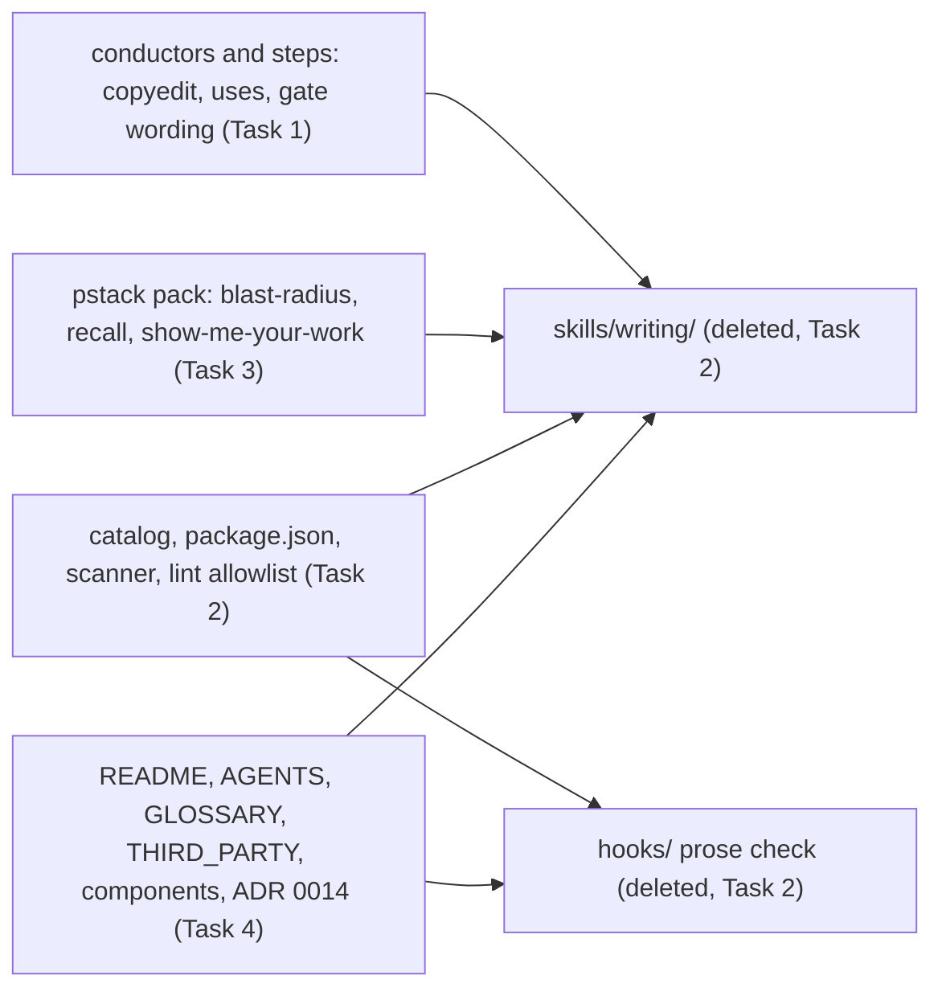

# Remove the writing skill Implementation Plan

<!-- glance -->

```
Plan: Remove the writing skill · 4 tasks · ~2485 lines · 43 files
 1  [1 Conductors and steps st…]
 2  [2 Delete the skill and th… ←1]
 3  [3 pstack's references to … ←2]
 4  [4 Docs drop the skill, th… ←2,3]

#  does                                                          files  adds         size
1  Every conductor goes from writing a document straight to it…  14     nothing new  ~45
2  The writing skill's folder and flows' only hook are gone, w…  17     nothing new  ~2330
3  The three pstack skills that told the agent to load `flows:…  4      nothing new  ~20
4  The repository's docs describe flows as it now is.            8      nothing new  ~90
```

<!-- /glance -->

> **For agentic workers:** follow the execution method Gate 1 picks. Steps use checkbox (`- [ ]`) syntax for tracking.

**Goal:** Remove flows' `writing` skill, its copyedit pass and the prose-check hook, and leave every conductor, the
pstack pack and the docs consistent without them.

**Architecture:** Deletion in four steps. First the conductors and steps stop running the copyedit and stop naming
`flows:writing`, so the build no longer needs the skill. Then the skill and the hook are deleted with their wiring.
The pstack sync adapter rewrites its three `unslop` references to plain wording, and the pack is re-synced at its
pinned commit. Last, the docs drop the three terms.

What still points at the removed parts, and which task cuts each link:



**Tech Stack:** Markdown and TOML flow sources, Node scripts, the TypeScript upstream-sync adapter.

**Spec:** none; the target shape is under **Options** in [flow.md](flow.md).

## Global Constraints

- Behaviour doesn't change: tests that passed before still pass. The exceptions, approved at Gate 1, are the deleted
  tests of the removed features: `plugins/flows/skills/writing/tests/writing-skill.test.mjs`,
  `plugins/flows/skills/writing/tests/copyedit.test.mjs`, `plugins/flows/hooks/prose.test.mjs` and
  `plugins/flows/hooks/hooks.test.mjs`.
- One implementation gets no interface; one caller gets no helper; no option nobody sets.
- Vendored pack files change only through `npm run sync -- apply pstack-picks --ref 6b0300214a09fd6029cfb7077043125758cd1fd2`,
  never by hand.
- Never edit `.claude-plugin/` or `.agents/plugins/`; `npm run build:harnesses` regenerates them.
- Docs under `docs/features/` and `docs/audits/` are history and stay as they are.
- Stack skill: none (prose, TOML and Node scripts).

## Test seams

- `npm test` (check-repo, then every suite): catches a leftover `[step: copyedit]` (compose stops on an unknown step),
  a leftover `flows:writing` in a `uses:` (check-repo's flows-uses check), a stale generated README tree or
  dependency list, and a package.json glob that matches no file. It misses stale wording in docs.
- `rg` over the tree for the removed names: catches stale wording in docs and comments. It misses nothing it is
  pointed at, but only finds the names it is given.

No new tests: a removal adds no behaviour.

## Review Focus

- A conductor that still tells the gate to say whether a document was copyedited: the gate message would carry a
  line about a step that no longer exists. Task 1's `rg` covers it.
- pstack's re-sync at the pinned commit changing more than the three rewritten lines: Task 3 checks the diff is only
  those lines.

---

### Task 1: Conductors and steps stop running the copyedit

**Does:** Every conductor goes from writing a document straight to its gate, and nothing in flows' skills or steps
names the writing skill.
**Depends on:** none
**Adds:** nothing new
**Size:** ~45

**Files:**

- Delete: `plugins/flows/steps/copyedit.toml`
- Modify: `plugins/flows/steps/gate.toml`
- Modify: `plugins/flows/steps/plan-check.toml`
- Modify: `plugins/flows/steps/run-rules.toml`
- Modify: `plugins/flows/steps/close.toml`
- Modify: `plugins/flows/skills/build-feature/SKILL.md`
- Modify: `plugins/flows/skills/research-feature/SKILL.md`
- Modify: `plugins/flows/skills/refactor/SKILL.md`
- Modify: `plugins/flows/skills/upgrade/SKILL.md`
- Modify: `plugins/flows/skills/implement/SKILL.md`
- Modify: `plugins/flows/skills/review-code/SKILL.md`
- Modify: `plugins/flows/skills/review-code/references/report.md`
- Modify: `plugins/flows/skills/review-code/references/docs.md`
- Modify: `plugins/flows/skills/diagrams/SKILL.md`

- [ ] **Step 1: Remove the step and its lines.** Delete `copyedit.toml` and every `[step: copyedit]` line (build-feature
      118, research-feature 116, refactor 89, upgrade 91, review-code 129), with the blank line after each.
- [ ] **Step 2: Remove the copyedit wording.**
  - `gate.toml`: the bullet "The gate message says whether the document it shows was copyedited…", and "Render after
    the copyedit." in the diagrams bullet.
  - `plan-check.toml`: "and again after its copyedit" in the first sentence.
  - `run-rules.toml`: ", the copyedit" in the list of independent checks.
  - `close.toml`: `"flows:writing"` in `uses` and the sentence "Revise it by `flows:writing`."
  - build-feature Gate 2: "Before it, copyedit the edited plan (Phase 3), then re-run glance on it (Phase 4)." becomes
    "Before it, re-run glance on the edited plan (Phase 4)."
  - research-feature line 102: `` `research.md`, copyedited, then `` becomes `` `research.md`, then ``.
  - refactor line 87: "Then, for both sizes and once, after any plan review, the plan is copyedited and checked again
    before the gate:" is deleted with the step line.
  - upgrade line 76: the sentence "flow.md is never copyedited, so the gate message says `not copyedited: no plan`."
    is deleted; line 87: "written, copyedited and checked" becomes "written and checked".
  - implement lines 87-88: the paragraph "Neither is copyedited…" is deleted.
  - review-code: `flows:writing, ` leaves the `uses:` line; the Phase 5 comment becomes
    `<!-- runs: report.md · output: one screen, `docs/audits/…` -->` and "Follow [references/report.md](…), then
    copyedit the audit file:" becomes "Follow [references/report.md](references/report.md)."
  - review-code `references/report.md:52`: the bullet "The copyedit (Phase 5) runs on the file before the gate…" is
    deleted.
  - review-code `references/docs.md:66`: "Docs the diff changed, read against `flows:writing`, loaded with the host's
    skill tool." becomes "Docs the diff changed, read as a reader who wasn't in the conversation would read them."
  - diagrams `SKILL.md:54`: "Check and render only after the copyedit, if the gate copyedits it." is deleted.
- [ ] **Step 3: Check.** Run `rg -n -i -e copyedit -e 'flows:writing' plugins/flows/skills plugins/flows/steps`, excluding
      `plugins/flows/skills/writing/`. Expected: no output. Run `npm run build:harnesses`. Expected: exit 0.

### Task 2: Delete the skill and the hook

**Does:** The writing skill's folder and flows' only hook are gone, with everything that wired them in.
**Depends on:** Task 1
**Adds:** nothing new
**Size:** ~2330

**Files:**

- Delete: `plugins/flows/skills/writing/SKILL.md`
- Delete: `plugins/flows/skills/writing/references/` (14 lesson and appendix files, `copyedit.md`)
- Delete: `plugins/flows/skills/writing/scripts/compare.mjs`
- Delete: `plugins/flows/skills/writing/tests/copyedit.test.mjs`
- Delete: `plugins/flows/skills/writing/tests/writing-skill.test.mjs`
- Delete: `plugins/flows/hooks/hooks.json`
- Delete: `plugins/flows/hooks/prose-check.mjs`
- Delete: `plugins/flows/hooks/prose.mjs`
- Delete: `plugins/flows/hooks/prose.test.mjs`
- Delete: `plugins/flows/hooks/hooks.test.mjs`
- Delete: `plugins/flows/hooks/fixtures/clean.md`
- Modify: `plugins/flows/plugin.json`
- Modify: `plugins/catalog.json`
- Modify: `package.json`
- Modify: `.github/skill-scanner.yaml`
- Modify: `tools/harness-compiler/src/lint-allowlist.json`
- Modify: `scripts/flows-uses.mjs`

- [ ] **Step 1: Delete** both folders.
- [ ] **Step 2: Unwire.**
  - `plugin.json`: drop the `hooks` key; the description becomes "Conductor skills, most with approval gates and
    resumable state: build, research, evaluate, review and learn, with the skill packs they run."
  - `catalog.json`: drop `"hooks/prose.mjs"` from flows' `resources`.
  - `package.json`: drop the `plugins/flows/skills/writing/tests/*.test.mjs` and `plugins/flows/hooks/*.test.mjs` globs
    from the `test` script.
  - `skill-scanner.yaml`: drop the `writing` / `tests/copyedit.test.mjs` suppression.
  - `lint-allowlist.json`: drop the `writing-skill.test.mjs` entry.
  - `flows-uses.mjs:20,57`: "(writing, diagrams)" becomes "(diagrams)".
- [ ] **Step 3: Check.** `npm test`. Expected: exit 0, no failing test; the four deleted test files are the only tests
      gone.

### Task 3: pstack's references to the writing skill become plain wording

**Does:** The three pstack skills that told the agent to load `flows:writing` say what to do in plain words instead.
**Depends on:** Task 2
**Adds:** nothing new
**Size:** ~20

**Files:**

- Modify: `tools/upstream-sync/src/adapters/pstack.ts`
- Modify: `plugins/flows/packs/pstack-picks/skills/blast-radius/SKILL.md`
- Modify: `plugins/flows/packs/pstack-picks/skills/recall/SKILL.md`
- Modify: `plugins/flows/packs/pstack-picks/skills/show-me-your-work/SKILL.md`

- [ ] **Step 1: Change the rewrites** (`pstack.ts:147-153`): "Write the brief through the **unslop** skill" → "Write
      the brief in plain words"; "Write it through `unslop`" → "Write it in plain words"; " (the **unslop** skill applies
      to log text too)", with its leading space, → "". Delete the `WRITING` constant. The `SKIPPED` comment on `unslop`
      and `technical-writing` becomes "not vendored; the REWRITES below turn their references into plain wording"; the
      `GUARD` comment's "needs a rewrite to flows' `writing` skill" becomes "needs a rewrite".
- [ ] **Step 2: Re-sync** with `npm run sync -- apply pstack-picks --ref 6b0300214a09fd6029cfb7077043125758cd1fd2`.
- [ ] **Step 3: Check.** `git diff --stat -- plugins/flows/packs/pstack-picks`. Expected: the three SKILL.md files, one
      line each; `UPSTREAM` unchanged. `npm run typecheck`. Expected: exit 0.

### Task 4: Docs drop the skill, the copyedit and the prose check

**Does:** The repository's docs describe flows as it now is.
**Depends on:** Task 2, Task 3
**Adds:** nothing new
**Size:** ~90

**Files:**

- Modify: `AGENTS.md`
- Modify: `README.md`
- Modify: `plugins/flows/README.md`
- Modify: `GLOSSARY.md`
- Modify: `THIRD_PARTY.md`
- Modify: `docs/components/flows.md`
- Modify: `docs/components/packs.md`
- Modify: `docs/adr/0014-prose-check-is-code-only.md`

- [ ] **Step 1: Edit.**
  - `AGENTS.md:25`: `flows:diagrams` is now the only model-invocable flows skill.
  - `README.md:69-72` and `plugins/flows/README.md` (the `/flows:writing copyedit` row and lines 163-180): drop the
    writing skill, the prose check and the copyedit.
  - `GLOSSARY.md`: drop the **Writing skill**, **Prose check** and **Copyedit pass** entries. **Conversation
    shorthand** stays only if another entry or doc still uses the term (`rg -n 'Conversation shorthand|conversation
shorthand'`); otherwise drop it too.
  - `THIRD_PARTY.md`: the pstack paragraph says `unslop` and `technical-writing` aren't vendored and the sync turns
    references to them into plain wording; drop the "writing (flows)" section.
  - `docs/components/flows.md:40-55`: drop the writing, prose-check and copyedit paragraphs; the diagrams paragraph
    no longer says "like `writing`".
  - `docs/components/packs.md:12`: as THIRD_PARTY's pstack line.
  - ADR 0014: one line under the title, "Superseded on 2026-11-10: the prose check, the copyedit and the writing skill
    were removed (`docs/features/refactor-writing/`)."
- [ ] **Step 2: Check.** `npm run build:harnesses`, then
      `rg -n -i -e copyedit -e 'flows:writing' -e 'prose.check' -e 'prose\.mjs' -e FLOWS_PROSE_CHECK -e 'skills/writing'`
      outside `docs/features/`, `docs/audits/`, `.claude-plugin/`, `.agents/` and `node_modules/`. Expected: only
      ADR 0014's own history and the two self-contained test fixtures named in flow.md's **Grounding**. Then `npm test`.
      Expected: exit 0.
