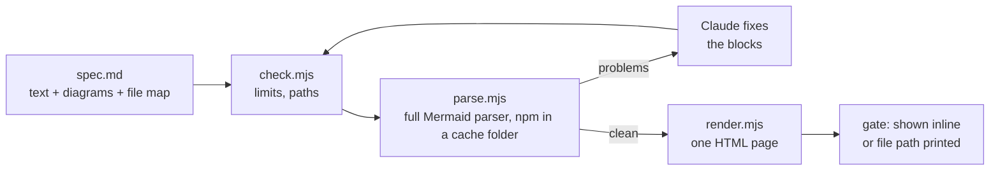

# Remove flow-cockpit, show a spec and its pictures as one page: spec

## Problem and point

The flow cockpit is a desktop app (13k lines of Rust, 5k of TypeScript, a Nix package, a Windows release and an installer entry) that the user has stopped using. It did two jobs. It hosted Claude sessions, which T3 Code now does better. It also drew flow runs and Mermaid diagrams, and the user still misses that: before something is built, they want to _see_ it, in several small pictures, because text alone is hard for them to judge.

This work deletes the cockpit completely and replaces its one useful job with something light. At a gate, the user reads the spec in one rendered page where the diagrams sit inside the text, beside the part they explain. They don't read harness text plus a second window. Claude writes the spec as markdown with Mermaid diagrams in it. A script checks the diagrams first, so Claude never shows a broken one and never has to look at a screenshot to find out. A second script renders the markdown and its diagrams as one styled HTML page.

## What the user sees

At Gate 1 (spec) and Gate 2 (plan), the flow shows one rendered page. In T3 Code it appears in the thread through `html_render`; anywhere else it is an HTML file whose path the flow prints, to open in a browser. The page is the spec itself, headings and tables and diagrams together. The gate question in the harness stays one line: approve, or what to change. If the work changes no architecture, the page has no diagrams and the flow says so, so a small fix costs nothing extra.

## Scope

In:

- Delete `tools/flow-cockpit/`, `plugins/opt-in/flow-cockpit/` (capture hooks, `views` skill, README), the `flow-cockpit` entries in `Cargo.toml`, `Cargo.lock`, `flake.nix`, `treefmt.toml`, `.gitattributes`, `.gitignore`, `plugins/catalog.json`, the three CI workflows, the installer (option, binary download, tests), the scripts and their tests, the root `package.json` test line, `THIRD_PARTY.md`, and the live prose in `README.md`, `AGENTS.md` and `GLOSSARY.md` (`CLAUDE.md` does not name the cockpit).
- Reword `plugins/flows/steps/state.toml` and `plugins/flows/skills/build-feature/scripts/glance.mjs` so they no longer name the cockpit. The `Waiting for you` prefix in `now:` stays as a convention; only the clause saying the cockpit reads it goes.
- A new skill `plugins/flows/skills/diagrams/` with two Node scripts, `check.mjs` and `render.mjs`, a parse helper `parse.mjs` that runs the full Mermaid parser from a small npm project (`package.json` and `package-lock.json`, installed into the user's cache folder, never into the plugin) and their tests, all below. Parser choice, decided by the user on 2026-11-08 during the build: the first plan used the Python package `mermaid-syntax-parser` through uv (the user had said "could we use pythons uv eco system that we already rely heavily on?"), but the build measured that its bundle holds parsers for only seven diagram types and rejects valid pie, erDiagram, gitGraph, mindmap, quadrantChart and xychart-beta diagrams; no other Python tool validates all types. The user then chose full Mermaid via npm over the seven-type parser ("Full Mermaid via npm"), accepting the npm packages (about 149 MB and 118 packages in the cache, measured in a scratch install).
- Cockpit-only guards the reviewers found: `scripts/flows-uses.mjs` `checkTemplates` (and its call in `scripts/check-repo.mjs` and its tests) is renamed and reworded to guard "the shapes glance and the gates rely on", and keeps every check it makes, since conductors and glance still read those shapes; the installer's folder-unpacking code (`tools/installer/system/net.ts`, the `folder`, `linuxHint` and `targets` fields) that only the cockpit used goes too. The installer already retires a plugin that leaves the catalog (`retiredPlugins`), so the removal gets a test of that.
- The flow steps that show a spec or plan at a gate (`gate.toml`, the spec and plan steps) call the skill when the work changes architecture.
- Delete ADRs 0005 and 0007 and the feature folders `docs/features/flow-observability/` and `docs/features/cockpit-harness/` (the user chose to delete the old records). No new ADR replaces them; git history keeps the reasoning.

Out, each with what happens instead:

- Hosting sessions, capture hooks, a live window, a list of runs across projects. T3 Code replaces them; nothing replaces the cross-project list.
- A generated model from which views are derived (Structurizr-like). Too heavy for what was asked.
- A local server or a persistent viewer. The page is a file, or inline in T3.
- Cleaning up what an earlier install left on the user's machine (`~/.claude/bin/flow-cockpit/`, `~/.local/state/flow-cockpit/capture/`, `~/.config/flow-cockpit/`). The plan checks whether the installer already has a removal path; if it has none, the run's final report names the folders for the user to delete.
- `docs/audits/*` and the older run records in `docs/features/*` (16 files in seven folders, plus the unmerged `api-mcp` run). The user's answer covered "past audits", but none of them audits the cockpit: they review other branches and mention it a few times in passing, so deleting them would remove unrelated reviews. They stay as history, edits to their mentions of deleted folders included (`flows-rework/plan.md` names two in code spans; no link checker reads them).

## What changes

```files
- tools/flow-cockpit/
- plugins/opt-in/flow-cockpit/
- docs/adr/0005-flow-cockpit-outside-claude-code.md
- docs/adr/0007-flow-cockpit-hosts-claude-sessions.md
- docs/features/flow-observability/
- docs/features/cockpit-harness/
~ Cargo.toml
~ Cargo.lock
~ flake.nix
~ treefmt.toml
~ .gitattributes
~ .gitignore
~ package.json
~ plugins/catalog.json
~ .github/workflows/crates.yml
~ .github/workflows/crates-build.yml
~ .github/workflows/release.yml
~ tools/installer/install.ts
~ tools/installer/core/binaries.ts
~ tools/installer/core/binaries.test.ts
~ tools/installer/core/options.ts
~ tools/installer/core/options.test.ts
~ tools/installer/core/plugins.test.ts
~ tools/installer/steps/binaries.ts
~ tools/installer/steps/binaries.test.ts
~ tools/installer/system/net.test.ts
~ scripts/ci-changes.mjs
~ scripts/ci-changes.test.mjs
~ scripts/flows-uses.mjs
~ scripts/flows-uses.test.mjs
~ scripts/check-repo.mjs
~ tools/installer/system/net.ts
~ .github/dependabot.yml
~ .github/skill-scanner.yaml
~ plugins/flows/README.md
~ plugins/flows/plugin.json
~ scripts/release.test.mjs
~ scripts/repo-facts.test.mjs
~ scripts/repo-scripts.test.mjs
~ plugins/flows/steps/state.toml
~ plugins/flows/steps/gate.toml
~ plugins/flows/skills/build-feature/scripts/glance.mjs
~ plugins/flows/skills/build-feature/tests/glance.test.mjs
~ README.md
~ AGENTS.md
~ GLOSSARY.md
~ THIRD_PARTY.md
+ plugins/flows/skills/diagrams/SKILL.md
+ plugins/flows/skills/diagrams/scripts/check.mjs
+ plugins/flows/skills/diagrams/scripts/parse.mjs
+ plugins/flows/skills/diagrams/scripts/render.mjs
+ plugins/flows/skills/diagrams/package.json
+ plugins/flows/skills/diagrams/package-lock.json
+ plugins/flows/skills/diagrams/tests/check.test.mjs
+ plugins/flows/skills/diagrams/tests/render.test.mjs
+ plugins/flows/skills/diagrams/tests/fixtures/api-mcp-diagrams.md
```

The new skill gets two scripts and a helper, and the flow's gate step learns to call it:



## The pictures

A picture earns its place only when seeing it beats reading it, and the right picture depends on the task. The user asked for this explicitly, and named one kind first: the file layout and which files change, shown graphically. The skill therefore holds a short menu of picture kinds and a rule for which kinds fit which task, and Claude picks per task, not one fixed set:

| Task | Pictures |
| --- | --- |
| New feature | file map, where it sits, what changes, the main flow and its failure case |
| Refactor or move | file map (moves and renames marked), before and after, what stays untouched |
| Bug fix | the flow with the broken step marked, file map |
| Removal or migration | file map with deletions and counts, what still references the removed part |
| Small change (one file, no new boundary) | none; the page says no pictures were needed |

Two kinds of picture exist, both written as fenced blocks in the spec's own markdown, so the spec stays the one source and works in any markdown viewer, only plainer:

- **Mermaid diagrams** (```` ```mermaid ````), for relationships and flows. Each holds at most 8 nodes (6 participants in a sequence). One that wants more is split, not enlarged.
- **The file map** (```` ```files ````), for layout and change. One line per file: a marker (`+` new, `~` changed, `-` deleted, `>` moved: written `> old-path -> new-path`), then the path. The renderer draws it as a folder tree, coloured by marker, with a count of each marker per folder, and collapses folders with no change into one line. It is not Mermaid because Mermaid draws trees badly, and because a script can check it exactly (see the checker).

## The checker: `check.mjs`

It reads a markdown file and checks every ```` ```mermaid ```` and ```` ```files ```` block, printing one line per problem with the block number, and exiting non-zero on any error. Checks:

- the syntax parses (every diagram type), by the full Mermaid parser. `check.mjs` copies `package.json`, `package-lock.json` and `parse.mjs` into a folder in the user's cache, runs `npm ci --ignore-scripts` there when a stamp of those files has changed, and runs `node parse.mjs` from that folder, so the plugin folder never gets a `node_modules`. `parse.mjs` runs `mermaid.parse` under jsdom (the pinned Mermaid and jsdom) and returns, per diagram, whether it parsed, its type and Mermaid's error message, so Claude learns what to fix and not just which block failed. Mermaid reads the `config: layout: elk` frontmatter itself, so nothing is stripped. A failure of the parser step (no npm, the install fails or times out, node exits non-zero, output that is not the expected JSON) gives `not parser-checked: <reason>` and the checker goes on with the rest; that is a warning, not an error;
- for flowcharts only (a limit Claude chose; the user confirmed 8 and 6): at most 8 nodes and no node left without an edge, counted by `parse.mjs` from Mermaid's own parse result (`getDiagramFromText(...).db.getVertices()` and `getEdges()`), not guessed from the text. Mermaid's parser already rejects the reserved words a model gets wrong, so there is no word list of its own; and Mermaid creates a node for any edge end, so there is no "dangling edge" check;
- for sequence diagrams: at most 6 participants, from the same parse result (`getActors()`). Other types are parse-checked only.

For `files` blocks it runs against the repository: every `~`, `-` and `>` source path must exist, every `+` path must not, and a `>` target must not. A block a person wrote, as in a spec, holds a prediction from the grounding, so a mismatch there is a warning. For a plan, the checker builds the file map from the tasks' **Files** lists (the renderer's map, below) and checks that, and a mismatch is an error; a **Files** line is `Create`, `Modify` or `Delete`, a colon, then items separated by `, ` outside parentheses, each one backticked path with an optional parenthetical note (backticked text inside a note is not a path). Paths are checked in task order, so a `Modify` of a file an earlier task creates passes; a plan that cannot be parsed gets a warning and no map, and for a document the run may not edit (a given plan, flow.md) the gate shows a failing check as text instead of a page. This is the one check that compares a picture with the real repository, so Claude cannot draw a file map that disagrees with the code without being told.

The test fixtures are the four `api-mcp` diagrams from the 2026-11-08 test (three flowcharts, one sequence), kept in this run's `fixtures/api-mcp-diagrams.md` and copied into the checker's tests, with the `call` id restored in one copy so a test can fail on it. Tests that need the parser skip when the cache install cannot be made, so the Nix pre-commit check, which has no network, still passes.

It costs no browser and almost no tokens. It cannot say whether a picture is right or readable; those stay with the user's eyes and with Claude's check against the code, marked as inferred.

## The renderer: `render.mjs`

It takes a markdown file and writes one self-contained HTML file: the markdown as styled text, each Mermaid block as a diagram and each `files` block as a folder tree, inline where it was written. Diagrams use Mermaid's ELK layout, set once for the whole page, with one shared theme (type large enough to read, a fixed palette for new, kept and existing, edge labels with a background, a width limit). The page loads Mermaid and the markdown library from a CDN at exact versions held as constants in `render.mjs`; they are bumped by hand, since Dependabot cannot read them. Mermaid 12.3.0, whose ELK layout is bundled, is the starting point; two reviewers ran it under jsdom and it parsed all four fixtures. The folder tree is built in Node as HTML, with the native `<details>` element to collapse a folder, so the browser runs only the markdown library and Mermaid. The renderer runs the checker first and refuses to write a page when it fails. Given a plan (a file with `### Task <n>:` headings), it also builds the file map itself from the tasks' **Files** lists through the parser `glance.mjs` already has (exported, and extended to keep each path and its verb), so no one draws it: `Create` becomes `+`, `Modify` becomes `~`, `Delete` becomes `-`, and each task's files are grouped under its heading. The markdown travels inside the page as JSON, with `<` escaped so quoted HTML such as `</script>` cannot end the script early.

How it looks is the part a script cannot judge. The build looks at one screenshot of a real page through the web-mcp browser, which worked on this machine on 2026-11-08, and the user judges the result at the gate.

## Seams

- Which pictures a task needs: resolved in the diagrams skill's table; never seen by the checker or the renderer, which draw whatever blocks the markdown holds.
- Whether a picture is valid: resolved in `check.mjs` and its parse helper; never seen by the flow steps, which only call the skill and read its exit code.
- How a page looks: resolved in `render.mjs` and its one theme; never seen by the skill's drawing rules.
- Where a page is shown (inline or a file path): resolved in the gate step, in host-neutral words ("if the host has a tool that renders an HTML page in the conversation, show it there; otherwise print the file's path"); never seen by `render.mjs`, which only writes a file. Claude chose not to add a tool slot to the harness compiler, so the compiler, its two targets and their templates stay untouched.

## Done means

1. `git grep -il cockpit` matches only `docs/audits/` and the older records under `docs/features/` (and this run's own folder); the workspace builds without the two crates; `nix flake check` and the repository checks pass.
2. `check.mjs` fails on a block using `call` as a node id, a 9-node flowchart, a node with no edge and a seven-participant sequence, and passes on the four `api-mcp` diagrams from the test; each case is a test.
3. `render.mjs` on this very spec writes one page, and a screenshot of it through the web-mcp browser shows the diagrams and the file map inline, legible, without clipped labels. The spec's own file map (the deletion of the cockpit) is the test: it must check clean against a worktree of the commit the run branched from, because the deletions and new files it names no longer match the repository afterwards.
4. At Gate 1 of a real run, the flow shows the page in T3 and the user finds it as readable as the spec text (the user's judgment, not measured).
5. The installer no longer lists flow-cockpit, and a fresh install works.

## Risks and what is not known

- "On point" is a taste judgment; the theme will need rounds with the user.
- The file map is exact only once a plan exists, because the plan's task **Files** lists name the real paths. At Gate 1 it is a prediction from the grounding. The user first chose "spec only" and then, at Gate 1, chose to render the plan too, so Gate 2 shows the plan through the same renderer, with the exact map.
- The T3 inline render path was shown to work once with this page's CDN scripts (the user saw the diagrams); T3's own preview browser failed on this host for missing libraries and was never used.
- Codex has no inline render; there the flow prints a file path.
- The checker depends on two npm packages, `mermaid` and `jsdom`, run through Mermaid's `getDiagramFromText` (an internal-looking API; the versions are pinned and the tests cover it, but a Mermaid bump can break it). They add about 149 MB and 118 packages to the user's cache folder (measured in a scratch install), the ecosystem the user hesitated over before choosing it, and Dependabot's npm entry will propose bumps. Mermaid's versions in the checker and in the page (a CDN constant) are separate pins and can drift apart: a diagram valid for one could still fail in the other, and the page marks any diagram Mermaid rejects with a visible error box as a second net.
- npm must be installed (Node and npm come together in every Claude Code and Codex setup this repository supports; not checked on every platform). Where it is missing, or the first install (about 150 MB, at the first gate) fails or runs offline, the syntax check is skipped with a `not parser-checked` warning that the gate passes on, and only the lint runs.
- Collapsible subgraphs need Mermaid 11.17 or later; the spec does not rely on them.
- No comparable tool checks diagrams at a plan gate. Kiro shows an architecture diagram inside `design.md` with a rendered preview; its diagram format, any check and any splitting into views are not documented in the pages read.
- The installer may leave an old folder on machines where the cockpit was installed.
- `scripts/check-repo.mjs` has no rule naming the cockpit, and nothing outside `tools/flow-cockpit` depends on `flow-cockpit-core` (both verified by `git grep`); the harness lint's rules were not checked.
