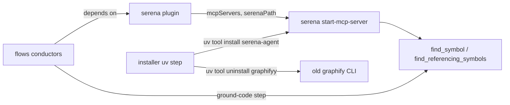

# Serena replaces graphify: spec

## Why

cartobench (`C:\Users\manue\.t3\projects\cartobench`, report written 2026-11-22, 15 repositories, 9,900 matched
questions per arm) measured code-mapping tools against rg on `def`, `callers`, `callees`, `users` and `localize`
questions. Serena ranks first (rating 1119, rg = 1000, median quality 100 %, 233 tokens). graphify ranks 6th (975,
below rg), and `graphify query`, the command graphify's skill sends questions to, ranks 14th (708, 4 % quality).
flows' grounding step asks exactly these questions, so flows should ask serena, not graphify.

## Goals

1. graphify is gone from what ships: no `graphify` plugin, no flows dependency or embed, no graphify text in flows,
   no installer step, no upstream sync, no vendored files.
2. A `serena` plugin in `plugins/shared/serena/` carries Serena's MCP server, on Claude Code and Codex. flows depends
   on it, as it depended on graphify.
3. flows' grounding uses serena's symbol tools when they are present, with the existing Explore fallback when not.
4. The installer installs Serena with its own uv and removes the old graphify CLI it installed.
5. Docs (README, AGENTS.md, THIRD_PARTY.md, plugin READMEs, ADRs) say what the code now does.

## Design

### The plugin

`plugins/shared/serena/plugin.json`, hand-written, MCP only (the `web-mcp` shape: a path config key plus one stdio
server), no hooks, no skills, nothing vendored:

```json
"config": {
  "serenaPath": { "type": "string", "title": "serena command",
    "description": "Path to the serena command. Default: serena on PATH.", "default": "serena" }
},
"mcpServers": {
  "serena": {
    "command": "${config.serenaPath}",
    "args": ["start-mcp-server", "--context", "ide", "--project-from-cwd",
             "--open-web-dashboard", "False", "--add-mode", "no-memories"]
  }
}
```

- `--context ide`, on both hosts: excludes serena's file, shell and listing tools that duplicate the host's built-ins
  and runs single-project; its prompt only says to prefer serena's tools. Not `claude-code`: that context's prompt
  makes built-in Read and Edit "FORBIDDEN" in every session (plan review round 1, S1; `contexts/claude-code.yml`).
  One args list then serves both hosts.
- `--project-from-cwd`: the project is the nearest folder with `.serena/project.yml` or `.git` above the session's
  directory, so no `activate_project` call is needed.
- `--open-web-dashboard False`: no window opens on each session start; the dashboard still runs on localhost.
- Side effect: serena writes `.serena/project.yml`, `project.local.yml` and `.gitignore` into each repository it
  activates. The plugin description, the root README, AGENTS.md and ADR 0016 say so; this repository ignores `/.serena/`.
- `--add-mode no-memories`: no memory tools, no onboarding, no `.serena/memories/` (picked by the user; matches the
  benchmark arm, which ran without them).
- `serenaPath`: Serena's docs say a client may not find `serena` even when it is on PATH (prior-art.md); the
  installer points the key at uv's copy (user's pick).
- No hooks: graphify's two `tool.starting` nudges go with it. Serena's own hooks are alpha for Claude Code
  (prior-art.md) and `--project-from-cwd` makes Codex's `activate` hook unnecessary in the CLI.

`plugins/catalog.json`: entry `serena`, source `plugins/shared/serena`, no resources, both targets. flows'
`dependencies` swap `graphify` for `serena`.

### Codex

Codex gets MCP servers through a generated setup skill (`tools/harness-compiler/src/templates/codex.ts`,
`integrationSetup`). serena joins it with:

```sh
codex mcp add dead-agent-skills-serena -- serena start-mcp-server --context ide --project-from-cwd --open-web-dashboard False --add-mode no-memories
```

built from plugin.json's args through the package's `codex-mcp.json`, plus `startup_timeout_sec = 15` (Serena's Codex
recipe) and a line that Serena is installed with `uv tool install -p 3.13 serena-agent`. flows' `"embeds": ["graphify"]`
goes (and the now unused `embeds` field leaves the compiler) (serena has no skills to embed). The installer's Codex step installs serena with the installer's uv, then adds the same server with
`codex mcp add` and uv's absolute `serena` path, as it does web-mcp's (added while planning: Goal 2 needs it on
installer-set-up Codex machines); the Codex host adapter and flows' Codex README drop graphify.

### flows

- `steps/ground-code.toml`: the graphify bullet becomes: when serena's tools are available, find the symbols the work
  touches and their references with them first, when they are available and return results, (`find_symbol`, `find_referencing_symbols`,
  `get_symbols_overview`), read-only (no symbol edits during grounding); then `pstack-picks:how`. `uses` drops
  `graphify:graphify`.
- `steps/missing-piece.toml`: the graphify row becomes `serena | symbol lookup | {{explore}}`.
- `skills/understand/SKILL.md`: description, `uses` and the Map phase drop graphify; the "offer `/graphify`" sentence
  goes.
- `references/resource-index.md` and `README.md`: graphify rows become serena where flows uses it, else go.

### Installer

- `assets/tools.json`: `graphify` entry replaced by `serena` (pypi `serena-agent`, Python 3.13, unpinned and installed
  with `--upgrade`, as graphify was under ADR 0012).
- After a successful install, it sets serena's `serenaPath` to `<uv tool dir --bin>/serena` (`serena.exe` on Windows) with
  `claude plugin configure serena@<marketplace> --values-stdin`, as `agentBrowserPath` is set
  (`steps/agent-browser.ts:58`); a failure is a summary line naming the path to set by hand.
- `steps/uv.ts`: `installGraphify` becomes `installSerena`
  (`uv tool install --upgrade -p 3.13 serena-agent`), returning uv's absolute `serena` path, or nothing when the
  install failed (then `serenaPath` is left alone). A failure line says to close Claude Code and Codex sessions and
  rerun (a running serena may lock its files on Windows). When this run retires graphify (either host), a uv copy already
  exists and uv lists `graphifyy`, it runs `uv tool uninstall graphifyy` once (no uv download just for this); each outcome a summary line.
- `install.ts`, `core/binaries.ts`, `core/options.ts` (Tools page key), tests and fixtures: graphify → serena.
- The retired `graphify@dead-claude-skills` plugin is removed by the existing `retiredPlugins` rule
  (`core/plugins.ts:82`); nothing new is needed for that.

### Removed

`plugins/shared/graphify/`, `tools/upstream-sync/src/adapters/graphify.ts` and its `sources.ts` entry and test lines,
the `treefmt.toml` exclude, the `lint-allowlist.json` entry, the Codex description, the `.gitignore` lines for
`graphify-out/`, THIRD_PARTY.md's graphify section.

### Seams

- serena's launch flags: resolved in `plugins/shared/serena/plugin.json` for both hosts (one args list); the
  Codex setup skill and the installer's Codex step read them from the built package's `codex-mcp.json`; never seen
  by flows' steps or skills.
- Where the serena command lives: resolved in the installer (sets `serenaPath`); never seen by flows.
- Codex retires graphify too: a plugin of ours gone from the catalog is removed, as `retiredPlugins` does for
  Claude Code.
- Whether serena is installed: resolved in the installer's uv step (`steps/uv.ts`); never seen by the plugin or flows,
  which fall back to Explore when serena's tools are absent.

## Not doing

- Serena's hooks, its dashboard settings beyond not opening it, `serena init`, pre-fetching language servers
  (`serena download-ls-dependencies`), JetBrains backend, HTTP mode.
- A version pin for serena-agent (uv tools stay unpinned under ADR 0012).
- Rewriting old `docs/features/*` and `docs/audits/*` that mention graphify: they are history.

## Decided in the grill

- ADR 0016 records the swap: [0016](../../adr/0016-serena-replaces-graphify.md).
- A `serenaPath` config key, set by the installer (above).

## Pictures

Where serena sits, after the change (graphify's place, struck through in words: it had a vendored skill and two
hooks; serena has neither):



What changes (predicted from grounding; tests and fixtures named by folder in the plan):

```files
- plugins/shared/graphify/plugin.json  the vendored graphify plugin goes, with its skills, hooks and licences
+ plugins/shared/serena/plugin.json  serenaPath config and the serena MCP server
~ plugins/catalog.json  graphify entry out, serena in, flows depends on serena
~ plugins/flows/plugin.json  embeds graphify goes
~ plugins/flows/steps/ground-code.toml  serena's symbol tools instead of graphify-out
~ plugins/flows/steps/missing-piece.toml  serena row
~ plugins/flows/skills/understand/SKILL.md  no graphify
~ plugins/flows/references/resource-index.md  no graphify row
~ plugins/flows/README.md  graphify becomes serena
~ tools/harness-compiler/src/templates/codex.ts  serena setup command
~ tools/harness-compiler/src/targets/codex.ts  description and setup list
~ tools/harness-compiler/src/templates/hosts/codex.md  no bundled graphify
~ tools/harness-compiler/src/lint-allowlist.json  graphify entry goes
~ tools/installer/assets/tools.json  serena-agent instead of graphifyy
~ tools/installer/steps/uv.ts  installSerena, uninstall graphifyy
~ tools/installer/install.ts  calls installSerena
~ tools/installer/core/binaries.ts  serena rows
~ tools/installer/core/options.ts  Tools page key
- tools/upstream-sync/src/adapters/graphify.ts  no sync
~ tools/upstream-sync/src/sources.ts  graphify source goes
+ docs/adr/0016-serena-replaces-graphify.md  the decision
~ AGENTS.md  layout line
~ README.md  install lines
~ THIRD_PARTY.md  graphify section goes
~ treefmt.toml  exclude goes
plugins/catalog.json uses plugins/shared/serena/plugin.json
tools/installer/install.ts uses tools/installer/steps/uv.ts
```
